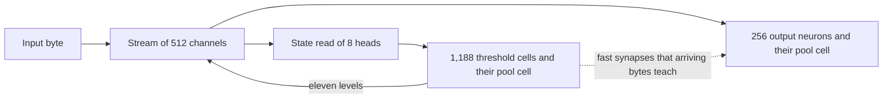

# ShuntFormer v15 model card

The checkpoint is a 34,810,812-parameter spike-only stack trained
from random weights for 368,640,000 byte targets. It is a new
decoder. Each of its eleven levels is a state read of eight heads
and then a layer of 1,188 threshold cells with a pool cell, and
it has no blocks, no forecast neurons and no error bank. It reads
a stream: its state is carried from byte to byte, and a text of
any length costs one step per byte.

The weights are not in the repository. The file is 140 MB and is
in the `long-windows` archive of the release as
`stream_form/long-windows/model.pt.averaged`. It holds the
running average of the weights, which is what the study scores.
The model that runs from a clone is still
[v11](../spiking-byte-lm-v11/README.md).
[Study, measurements and limits](../../docs/STREAM_FORM.md) · [Checkpoint and archive hashes](manifest.json) · [Restore and rescore](../../docs/V15_HANDOFF.md)

**The stack saw longer windows than its Transformer reads.** It
trained on windows of 512 bytes up to 24,000 updates and on
windows of 1,024 bytes from there, and it is scored with reads
that reach up to 4,096 cells back. The Transformer it is measured
against trained on windows of 512 bytes and reads 512. A
Transformer trained on windows of 1,024 bytes, the control, was
still training when this release was made. The same stack trained
on windows of 512 bytes throughout is released beside this one as
`stream_form/windows` and is 0.027 bpb behind the Transformer on
the test.
[What the window is worth](../../docs/STREAM_FORM.md#long-windows-did)

**Level, not ahead.** The checkpoint is ahead of the Transformer
on the enwik8 test split and behind it on the validation split,
and both intervals exclude zero. Every score here is one seed.
Two runs of a stack with different seeds were 0.001 to 0.005 bpb
apart during training.

## Stack



A level adds to the stream twice. Its state read turns the stream
at every byte into a tag, a payload and a probe of 512 channels
in eight heads. In a head the present byte's probe meets the tags
of the bytes before it. Each of those cells is charged by that
match times a learned gain, plus a learned offset for its age,
and the cells race for 256 spikes. Every cell spike passes that
cell's payload pulses on. Then a layer of 1,188 threshold cells
hears the stream through fibres that carry every channel now and
once more after one to three bytes, and their spikes go back into
the stream.


**The pool.** The neurons of a read and of a cell layer count
their threshold in quanta sixteen times finer than in v14, 64 to
a threshold. A pool cell hears the summed activity of the stream
and fires once for every 64 pulses, and each of its spikes raises
the threshold of its neurons by one quantum above a rest of four.
That is a division by the activity of the stream in spikes, and
it took the place of the normalisation that the float stand-ins
of the study needed.

**The reach.** In training a read reaches the cells of its
window: 512 at first, 1,024 in the long windows. In a stream the
cells are still there, so a read can reach further at no cost in
synapses. Cells beyond the trained window take the age offset of
its oldest cell. The released scoring lets the reads after levels
5 to 7 reach 4,096 cells.

**Fast output synapses.** With `--teach-levels` the cells of the
named levels drive fast synapses into the output neurons. They
start at zero in every stream. When a byte arrives, the synapses
to its neuron grow by the share that the neuron missed and the
others shrink by the shares they took, in whole numbers.

| Part | Parameters |
|---|---:|
| 11 layers of threshold cells | 20,085,516 |
| 11 state reads | 14,463,152 |
| Input synapses | 131,072 |
| Output synapses | 131,072 |
| **Total** | **34,810,812** |

A cell layer has 1,216,512 synapses from the stream and its
delayed copies, 608,256 back into it and 1,188 resting
thresholds. A read has 1,310,720 synapses for probes, tags,
payloads and its way back into the stream, 4,096 age offsets and
16 gains and grains.

## Measured scope

The stack is scored on unbroken streams: an enwik8 split in 16
parts that run side by side, each after 8,192 unscored bytes of
the text before it, and each of the 16 PG-19 test books as a
stream of its own. The Transformer carries no state and reads the
same texts in windows with 496 bytes of history before 16 scored
ones, which is the window that suits it best.

| Model | Parameters | enwik8 test | enwik8 validation | PG-19 test |
|---|---:|---:|---:|---:|
| Transformer, windows of 512 bytes | 34,752,000 | 1.1439 | **1.1629** | 1.4265 |
| **This checkpoint, with its longer reach** | 34,810,812 | **1.1406** | 1.1694 | **1.4249** |
| This checkpoint, as trained | 34,810,812 | 1.1536 | 1.1828 | 1.4456 |
| The same stack on windows of 512 bytes, with its longer reach | 34,810,812 | 1.1709 | 1.1987 | 1.4618 |
| The same stack on windows of 512 bytes, as trained | 34,810,812 | 1.1852 | 1.2093 | 1.4761 |
| **With output synapses that the stream teaches** | | | | |
| Transformer, windows of 512 bytes | 34,752,000 | 1.1344 | **1.1574** | – |
| **This checkpoint, with its longer reach** | 34,810,812 | **1.1339** | 1.1649 | **1.4047** |
| The same stack on windows of 512 bytes, with its longer reach | 34,810,812 | 1.1603 | 1.1916 | – |

On the test split the checkpoint is 0.0033 bpb below the
Transformer, with a paired 95% interval of −0.0048 to −0.0018. On
the validation split it is 0.0065 above it, with an interval of
+0.0050 to +0.0079, and on PG-19 0.0016 below it, without an
interval. With fast output synapses on both sides it is 0.0005
below the Transformer on the test (−0.0018 to +0.0009) and 0.0075
above it on validation (+0.0062 to +0.0089). A dash marks a
scoring that was not run.

The last weights of the same run score 1.1534 on the test as
trained. In windows of 512 bytes with 256 unscored bytes, the
scoring of v13 and v14, the checkpoint scores 1.1951 and the
Transformer 1.1565.
[Leaderboard](../../docs/LEADERBOARD.md) · [Full results, controls and limits](../../docs/STREAM_FORM.md#complete-enwik8-test)

The trainer counts 313,735 pulses per byte on validation against
a budget of 310,000. That count is the trainer's own. No native
decoder has audited it.

The races are computed in closed form and in floating point, as
in v13 and v14. A cell's rate is its softmax share of the budget,
and fixed starting phases turn the rates into whole spikes. The
fast output synapses count in 64-bit floating point on whole
numbers, which is exact, and need a CPU or a CUDA GPU. Every
number is one seed. The run was resumed at 16,500 updates, forked
at 24,000 and resumed at 28,500.

Not measured for this checkpoint: a native integer run, a pulse
audit, and the held-out web pages, mathematics and source code of
v12.

## Rescore

```bash
python experiments/eval_stream.py --device cuda --enwik8 data/enwik8 \
  --checkpoint checkpoints/stream_form/long-windows/model.pt.averaged \
  --reach 4096 --reach-levels 5 6 7 \
  --json checkpoints/work/test_long_windows_reach.json
```

Without the two reach flags the stack is scored as trained.
`--teach-levels 0 1 2 3 4 5 6 7 8 9 10 --teach-threshold
16777216` adds the fast output synapses. `--device cpu` scores on
a CPU, and `--device mps` on an Apple GPU without the fast
synapses.

## Write text

```bash
python experiments/generate_stream.py checkpoints/stream_form/long-windows/model.pt.averaged \
  --prompt 'The first chapter' --bytes 256 --reach 4096 --reach-levels 5 6 7
```

The stream generator steps the stack once for every byte, which
is about 15 bytes per second on a laptop CPU, however long the
text behind it is. At its default temperature of 0.8 and seed 0
the checkpoint continues the prompt with

> of the poem (which is today the only step that you will not
> have a poem) to stand at the end of the college in the poem
> and a great observation that can be both direct and incapable
> of being intuitively associated with the college and in that
> society.
>
> For

Another machine can draw other bytes, since the races are
computed in floating point.

[Stack](../../snnformer/event_lm.py) · [Stream generator](../../experiments/generate_stream.py) · [Stream scorer](../../experiments/eval_stream.py) · [Test record](../../results/event_lm/stream_form/scores/test_long_windows_reach.json) · [Training record](../../results/event_lm/stream_form/runs/long-windows.json)

## License

Licensed under the GNU Affero General Public License, version 3 only (AGPL-3.0-only), copyright 2026 control-f and Daniel Tremer; commercial licenses without the AGPL's conditions are available from control-f. See the repository's [LICENSE](../../LICENSE) and [NOTICE](../../NOTICE).
