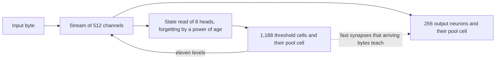

# ShuntFormer v16 model card

The checkpoint is a 34,810,900-parameter spike-only stack trained
from random weights for 368,640,000 byte targets: v15's stack of
eleven levels, each a state read of eight heads and a layer of
1,188 threshold cells, whose read heads learned a forgetting slope
of their own and which trained on windows of 2,048 bytes from
24,000 updates on. It reads a stream: its state is carried from
byte to byte, and a text of any length costs one step per byte.

The weights are not in the repository. The file is 140 MB and is
in the `l2048-forget` archive of the release as
`long_streams/l2048-forget/model.pt.averaged`, the running average
of the weights, which is what the study scores. The model that
runs from a clone is still
[v11](../spiking-byte-lm-v11/README.md).
[Study, measurements and limits](../../docs/LONG_STREAMS.md) · [Checkpoint and archive hashes](manifest.json) · [Restore and rescore](../../docs/V16_HANDOFF.md)

**Behind at equal training context.** A Transformer of the same
size that trained on the same windows of 2,048 bytes, and reads
the test in windows of 2,048 bytes, is 0.013 bits per byte ahead
of this checkpoint at its best, and 0.017 ahead with fast synapses
of its own. The checkpoint is 0.021 ahead of v15's release and
0.0017 behind a Transformer that trained on windows of 1,024
bytes. Every comparison is paired over the same pieces of the same
streams; every score is one seed, and second seeds of both models
are each about 0.003 better.

## Stack



Everything is v15's (see its [model card](../spiking-byte-lm-v15/README.md)) except two things.

**Forgetting slopes.** A read's cells within its window take a
learned offset for each age. A cell older than the window takes
the offset of the oldest age plus a slope times the number of
doublings of its age beyond the window, so its share of the read
falls as a power of its age. Each of the 88 heads learned its
slope (`--read-forget`). They settled at a median of −1.32
charge units a doubling, and 79 of them below −0.69, the slope
under which all far cells together take a bounded share of a read
at any reach. The middle levels forget most.

**Windows of 2,048 bytes.** The run trained on windows of 512
bytes in batches of 8 to 24,000 updates and on windows of 2,048
bytes in batches of 2, with its reads reaching 2,048 cells, for the
remaining 66,000: 4,096 targets an update throughout.

| Part | Parameters |
|---|---:|
| 11 layers of threshold cells | 20,085,516 |
| 11 state reads, with 88 forgetting slopes | 14,463,240 |
| Input synapses | 131,072 |
| Output synapses | 131,072 |
| **Total** | **34,810,900** |

## Measured scope

The stack is scored on unbroken streams: an enwik8 split in 16
parts that run side by side, each after 8,192 unscored bytes of
the text before it. The Transformers carry no state and read the
same texts in windows of their training length, 16 scored bytes
after the rest as history.

| Model | Parameters | enwik8 test | enwik8 validation |
|---|---:|---:|---:|
| Transformer, windows of 2,048 bytes | 34,752,000 | **1.1067** | **1.1303** |
| Transformer, windows of 2,048 bytes, with taught output synapses | 34,752,000 | **1.1032** | **1.1290** |
| Transformer, windows of 1,024 bytes | 34,752,000 | 1.1182 | 1.1410 |
| **This checkpoint, reaching 8,192 cells, with taught output synapses** | 34,810,900 | **1.1199** | **1.1514** |
| This checkpoint, reaching 8,192 cells | 34,810,900 | 1.1235 | 1.1537 |
| This checkpoint, as trained (2,048 cells) | 34,810,900 | 1.1367 | 1.1662 |
| `l2048-flat`, the same with the slopes held at zero, as trained | 34,810,900 | 1.1390 | 1.1687 |
| v15's release, reaching 4,096 cells at levels 5 to 7 | 34,810,812 | 1.1406 | 1.1694 |

On the test split, with taught output synapses, the checkpoint is
0.0132 above the Transformer that trained on 2,048 bytes [+0.0122,
+0.0143], 0.0167 above it when both have taught synapses [+0.0158,
+0.0176], and 0.0017 above the Transformer that trained on 1,024
bytes [+0.0005, +0.0030]. On validation it is 0.0210 above the
Transformer on 2,048 bytes [+0.0200, +0.0221] and 0.0103 above the
one on 1,024 [+0.0091, +0.0116]. Reaching 8,192 cells gains 0.0132 over
the trained reach [−0.0138, −0.0126]; the reach was chosen on the
first million validation bytes. The learned slopes gain 0.0024
over slopes held at zero at the trained reach [−0.0028, −0.0019].

The trainer counts about 311,000 pulses per byte on validation
against a budget of 310,000. That count is the trainer's own, and
no native decoder has audited it. The races are computed in closed
form and in floating point; the fast output synapses count in
64-bit floating point on whole numbers, which is exact, and need a
CPU or a CUDA GPU. The run was forked at 24,000 updates from the
saved state of `p-forget`, v15's recipe with forgetting slopes on
windows of 512 bytes.

Not measured for this checkpoint: whole PG-19 books as single
streams, a native integer run and a pulse audit.

## Rescore

```bash
python experiments/eval_stream.py --device cuda --enwik8 data/enwik8 \
  --checkpoint checkpoints/long_streams/l2048-forget/model.pt.averaged \
  --reach 8192 --piece 256 --teach-levels 0 1 2 3 4 5 6 7 8 9 10 --teach-threshold 16777216 \
  --json checkpoints/work/l2048-forget.taught-test.json
```

Without the teaching flags the stack is scored without fast output
synapses, and without `--reach` as trained. `--device cpu` scores
on a CPU.

## Write text

```bash
python experiments/generate_stream.py checkpoints/long_streams/l2048-forget/model.pt.averaged \
  --prompt 'The first chapter' --bytes 256 --reach 8192
```

[Stack](../../snnformer/event_lm.py) · [Stream scorer](../../experiments/eval_stream.py) · [Scores](../../results/event_lm/long_streams/scores) · [Long-streams study](../../docs/LONG_STREAMS.md)

## License

Licensed under the GNU Affero General Public License, version 3 only (AGPL-3.0-only), copyright 2026 control-f and Daniel Tremer; commercial licenses without the AGPL's conditions are available from control-f. See the repository's [LICENSE](../../LICENSE) and [NOTICE](../../NOTICE).
