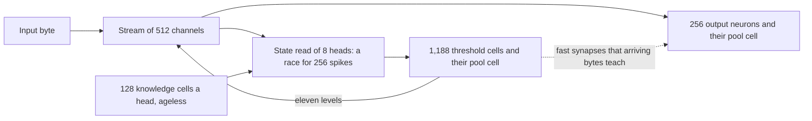

# ShuntFormer v17 model card

The checkpoint is a 36,263,956-parameter spike-only stack trained
from random weights for 368,640,000 byte targets. It is v16's
stack: eleven levels, each a state read of eight heads with
forgetting slopes and a layer of 1,188 threshold cells. To it v17
adds 128 learned knowledge cells in every read head's race, and
from 24,000 updates on it trained on unbroken streams of windows
of 2,048 bytes. It reads a stream: its state is carried from byte
to byte, and a text of any length costs one step per byte.

The weights are not in the repository. The file is 145 MB and is
in the `l2048-know-st` archive of the release as
`knowledge_gap/l2048-know-st/model.pt.averaged`. That file is the
running average of the weights, which is what the study scores.
The model that runs from a clone is still
[v11](../spiking-byte-lm-v11/README.md).
[Study, measurements and limits](../../docs/KNOWLEDGE_GAP.md) · [Checkpoint and archive hashes](manifest.json) · [Restore and rescore](../../docs/V17_HANDOFF.md)

**License:** Apache-2.0, copyright 2026 control-f and Daniel Tremer ([LICENSE](../../LICENSE), [NOTICE](../../NOTICE)).

**Behind by 0.010.** A Transformer of about the same size
(34,752,000 parameters), trained on the same data and windows,
reads the test in windows of 2,048 bytes. It is ahead of this
checkpoint at its best by 0.0103 bits per byte on test (paired 95%
interval 0.0092 to 0.0114) and by 0.0193 on validation (0.0182 to
0.0205). The checkpoint is 0.003 ahead of v16's release on test
and 0.002 on validation. Every score is one seed.

## Stack



Everything is v16's (see its [model card](../spiking-byte-lm-v16/README.md)) except two things.

**Knowledge cells.** A read head races the cells of the stream
within its reach for a budget of spikes and passes on the winners'
payloads. Knowledge cells join every race and never age: 128 a
head, each a learned tag and payload. They give a head a place to
put its spikes when nothing in its reach fits, as attention sinks
and registers do in Transformers. On the test bed a single one a
head gives more than the copying gain of all 128, and at four
seeds it removes the seed lottery of copying
(`results/event_lm/knowledge_gap/attention_sink.json`).

**Trained on streams.** From 24,000 updates on, the run trained on
15 groups of unbroken streams, each 10 windows of 2,048 bytes that
continue each other. The state is handed on from window to window
without a gradient. v16 trained on separate windows.

| Part | Parameters |
|---|---:|
| 11 layers of threshold cells | 20,085,516 |
| 11 state reads, with 88 forgetting slopes | 14,463,240 |
| Knowledge cells, 128 in each of 88 heads | 1,453,056 |
| Input synapses | 131,072 |
| Output synapses | 131,072 |
| **Total** | **36,263,956** |

## Measured scope

The stack is scored on unbroken streams: an enwik8 split in 16
parts that run side by side, each after 8,192 unscored bytes of
the text before it. The Transformers carry no state. They read the
same texts in windows of their training length, scoring 16 bytes
in each window with the rest as history.

| Model | Parameters | enwik8 test | enwik8 validation |
|---|---:|---:|---:|
| Transformer, windows of 2,048 bytes | 34,752,000 | **1.1067** | **1.1303** |
| **This checkpoint, reaching 8,192 cells, with taught output synapses** | 36,263,956 | **1.1170** | **1.1496** |
| This checkpoint, reaching 8,192 cells | 36,263,956 | 1.1210 | 1.1515 |
| This checkpoint, as trained (2,048 cells) | 36,263,956 | 1.1357 | 1.1652 |
| v16's release, reaching 8,192 cells, with taught output synapses | 34,810,900 | 1.1199 | 1.1514 |
| v16's stack at 22 levels, the same pulse budget, reaching 8,192, taught | 69,359,656 | 1.0926 | 1.1230 |
| Transformer at 22 layers, windows of 2,048 bytes | 69,371,904 | **1.0704** | **1.0930** |

Taught output synapses start at zero in every stream and learn
from each byte after it was predicted, at a threshold of 2^24
units of fast charge to a spike, on all eleven levels. Nothing
takes a gradient on test text.

## Where the gap is

Split byte by byte by what each byte's context offers, the stack
remembers better than the Transformer at every distance. Copying
from the last 2 KB it is 0.09 bits per byte better, and copying
from 2 to 8 KB back 0.31 better. On new contexts, three quarters
of the bytes, it is 0.06 behind. The gap is knowledge, and on the
test bed it reopens with more data
([study](../../docs/KNOWLEDGE_GAP.md)).

## Limits

- One seed at full size.
- The knowledge cells add 4.2% of parameters; by the stack's depth
  scaling, that is worth about 0.002 bits per byte.
- The knowledge cells missed their own pre-registered mark: at the
  trained reach they gain 0.001 over v16's stack, where 0.005 was
  asked. The 0.003 gain at the best reading includes the reach and
  the fast synapses.
- The run also changed from windows to streams, so at full size
  the two changes are not separated.
- The trainer counts about 311,500 pulses per byte against a
  budget of 310,000. That count is the trainer's own, and no
  native decoder has audited it.
- Not measured for this checkpoint: whole PG-19 books as single
  streams, a native integer run and a pulse audit.

## Rescore

```bash
python experiments/eval_stream.py --device cuda --enwik8 data/enwik8 --split test \
  --checkpoint checkpoints/knowledge_gap/l2048-know-st/model.pt.averaged \
  --reach 8192 --piece 256 --teach-levels 0 1 2 3 4 5 6 7 8 9 10 --teach-threshold 16777216 \
  --json checkpoints/work/l2048-know-st.taught-test.json
```

Without the teaching flags the stack is scored without fast output
synapses, and without `--reach` as trained. `--device cpu` scores
on a CPU.

[Stack](../../snnformer/event_lm.py) · [Stream scorer](../../experiments/eval_stream.py) · [Knowledge-gap study](../../docs/KNOWLEDGE_GAP.md) · [Roadmap](../../docs/ROADMAP.md)
