# Volley v18 model card

The checkpoint is a 36,264,308-parameter spike-only stack trained
from random weights for 368,640,000 byte targets. It is v17's
stack, v16's eleven levels with 128 knowledge cells in every read
head's race, trained on unbroken streams from 24,000 updates on,
with one change: in every state read, one of the eight heads is a
word head. It reads a stream: its state is carried from byte to
byte, and a text of any length costs one step per byte.

The weights are not in the repository. The file is 145 MB and is
in the `l2048-word-st` archive of the release as
`knowledge_gap/l2048-word-st/model.pt.averaged`. That file is the
running average of the weights, which is what the study scores.
The model that runs from a clone is still
[v11](../spiking-byte-lm-v11/README.md).
[Study, measurements and limits](../../docs/SCALING_LAW.md) · [Checkpoint and archive hashes](manifest.json) · [Restore and rescore](../../docs/V18_HANDOFF.md)

**License:** AGPL-3.0-only, copyright 2026 control-f and Daniel Tremer; commercial licenses from control-f ([LICENSE](../../LICENSE), [NOTICE](../../NOTICE)).

**Behind by 0.009.** A Transformer of about the same size
(34,752,000 parameters), trained on the same data and windows,
reads the test in windows of 2,048 bytes. It is ahead of this
checkpoint at its best by 0.0095 bits per byte on test and by
0.0188 on validation; with fast output synapses of its own it is
ahead by 0.0129 and 0.0201. The checkpoint is the best spike-only
stack so far, 0.0009 ahead of v17's on test (paired 95% interval
0.0004 to 0.0013) and 0.0006 on validation (0.0001 to 0.0010).
That is less than the 0.003 that the word heads' own record asked,
so word heads failed their mark (`results/event_lm/knowledge_gap/full_size_word_heads.json`).
Every score is one seed.

## Stack

```mermaid
flowchart LR
    B["Input byte"] --> S["Stream of 512 channels"]
    S --> R["State read of 8 heads: a race for 256 spikes"]
    W["Word head: the present word's cells, by place"] --> R
    K["128 knowledge cells a head, ageless"] --> R
    R --> C["1,188 threshold cells and their pool cell"]
    C -->|"eleven levels"| S
    S --> V["256 output neurons and their pool cell"]
    C -.->|"fast synapses that arriving bytes teach"| V
```



Everything is v17's (see its [model card](../spiking-byte-lm-v17/README.md)) except the word heads.

**Word heads.** In the brain a word is a cycle of a slow rhythm
that every word onset resets, its letters in the cycle's slots. A
letter neuron and an onset neuron with fixed synapses mark where a
word begins. The first head of every read reaches only the present
word's cells, from its first letter, and weighs each by its place
in the word, up to 32 places, so a prefix is one pattern however far
into its word the reading stands. That adds 32 learned offsets a
level, 352 parameters in all. On the test bed word heads gained
0.023 at 6,000 updates and 0.005 at 24,000, all of it memory
(`word_heads_with_data.json`); at full size they gain 0.0009.

| Part | Parameters |
|---|---:|
| 11 layers of threshold cells | 20,085,516 |
| 11 state reads, with 88 forgetting slopes and 352 word-place offsets | 14,463,592 |
| Knowledge cells, 128 in each of 88 heads | 1,453,056 |
| Input synapses | 131,072 |
| Output synapses | 131,072 |
| **Total** | **36,264,308** |

## Measured scope

The stack is scored on unbroken streams: an enwik8 split in 16
parts that run side by side, each after 8,192 unscored bytes of
the text before it. The Transformers carry no state. They read the
same texts in windows of their training length, scoring 16 bytes
in each window with the rest as history.

| Model | Parameters | enwik8 test | enwik8 validation |
|---|---:|---:|---:|
| Transformer, windows of 2,048 bytes, with taught output synapses | 34,752,000 | **1.1032** | **1.1290** |
| Transformer, windows of 2,048 bytes | 34,752,000 | 1.1067 | 1.1303 |
| **This checkpoint, reaching 8,192 cells, with taught output synapses** | 36,264,308 | **1.1162** | **1.1491** |
| v17's release, the same reading | 36,263,956 | 1.1170 | 1.1496 |
| v16's release, the same reading | 34,810,900 | 1.1199 | 1.1514 |

The reach of 8,192 cells was chosen on the first million
validation bytes (1.1768 there, against 1.1928 at the trained
2,048). Taught output synapses start at zero in every stream and
learn from each byte after it was predicted, at a threshold of
2^24 units of fast charge to a spike, on all eleven levels. Nothing
takes a gradient on test text.

## Where the gap is

Split byte by byte by what each byte's context offers, the stack
remembers better than the Transformer at every distance: copying
from the last 2 KB it is 0.10 bits per byte better on test, and
copying from 2 to 8 KB back 0.40 better. On new contexts, three
quarters of the bytes, it is 0.057 behind on test and 0.069 on
validation, as v17 was. The gap is knowledge
([study](../../docs/SCALING_LAW.md)).

## Limits

- One seed at full size.
- Word heads failed their pre-registered mark: 0.0009 where 0.003
  was asked.
- This checkpoint trained at a peak rate of 3e-4 with membranes
  that a higher rate saturates; v18's pilots show the rate's
  effect at full size, and the pair at each model's best rate runs
  for v19.
- The trainer counts about 311,000 pulses per byte against a
  budget of 310,000. That count is the trainer's own, and no
  native decoder has audited it.
- Not measured for this checkpoint: whole PG-19 books as single
  streams, a native integer run and a pulse audit.

## Rescore

```bash
python experiments/eval_stream.py --device cuda --enwik8 data/enwik8 --split test \
  --checkpoint checkpoints/knowledge_gap/l2048-word-st/model.pt.averaged \
  --reach 8192 --piece 256 --teach-levels 0 1 2 3 4 5 6 7 8 9 10 --teach-threshold 16777216 \
  --json checkpoints/work/l2048-word-st.taught-test.json
```

Without the teaching flags the stack is scored without fast output
synapses, and without `--reach` as trained. `--device cpu` scores
on a CPU.

[Stack](../../snnformer/event_lm.py) · [Stream scorer](../../experiments/eval_stream.py) · [Scaling-law study](../../docs/SCALING_LAW.md) · [Roadmap](../../docs/ROADMAP.md)
