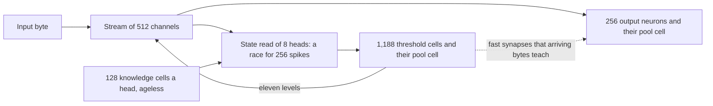

# Volley v19 model card

The checkpoint is a 36,263,956-parameter spike-only stack trained
from random weights for 368,640,000 byte targets. It is v17's
stack, v16's eleven levels with 128 knowledge cells in every read
head's race, trained on unbroken streams from 24,000 updates on,
with one change: it trained at a peak learning rate of 6e-4, the
rate at which the full-size stack trains best, where v17 trained
at 3e-4. It reads a stream: its state is carried from byte to
byte, and a text of any length costs one step per byte.

The weights are not in the repository. The file is 145 MB and is
in the `fsp-st` archive of the release as
`full_size_pair/fsp-st/model.pt.averaged`. That file is the
running average of the weights, which is what the study scores.
The model that runs from a clone is still
[v11](../spiking-byte-lm-v11/README.md).
[Study, measurements and limits](../../docs/SCALING_LAW.md) · [Checkpoint and archive hashes](manifest.json) · [Restore and rescore](../../docs/V19_HANDOFF.md)

**License:** AGPL-3.0-only, copyright 2026 control-f and Daniel Tremer; commercial licenses from control-f ([LICENSE](../../LICENSE), [NOTICE](../../NOTICE)).

**Behind by 0.034.** A Transformer of about the same size
(34,752,000 parameters), trained on the same data and windows at
its own best rate, 1.2e-3, reads the test in windows of 2,048
bytes. It is ahead of this checkpoint by 0.0339 bits per byte on
test (paired 95% interval 0.0328 to 0.0351) and by 0.0425 on
validation; with fast output synapses of its own it is ahead by
0.0357 and 0.0428. The checkpoint is the best spike-only stack so
far, 0.0042 ahead of v17's on test (0.0036 to 0.0047) and 0.0024
on validation (0.0018 to 0.0030), and 0.0033 ahead of v18's word
heads on test. Both models gain from their best rates, but the
Transformer gains 0.028 and the stack 0.004, so the gap at each
model's best rate is wider than v17's 0.010 at a shared rate
(`results/event_lm/knowledge_gap/full_size_best_rate_pair.json`).
Every score is one seed.

## Stack



Everything is v17's (see its [model card](../spiking-byte-lm-v17/README.md)); only the learning rate changed.

| Part | Parameters |
|---|---:|
| 11 layers of threshold cells | 20,085,516 |
| 11 state reads, with 88 forgetting slopes | 14,463,240 |
| Knowledge cells, 128 in each of 88 heads | 1,453,056 |
| Input synapses | 131,072 |
| Output synapses | 131,072 |
| **Total** | **36,263,956** |

## Measured scope

The stack is scored on unbroken streams: an enwik8 split in 16
parts that run side by side, each after 8,192 unscored bytes of
the text before it. The Transformers carry no state. They read the
same texts in windows of their training length, scoring 16 bytes
in each window with the rest as history.

| Model | Peak rate | Parameters | enwik8 test | enwik8 validation |
|---|---:|---:|---:|---:|
| Transformer, windows of 2,048 bytes, with taught output synapses | 1.2e-3 | 34,752,000 | **1.0771** | **1.1044** |
| Transformer, windows of 2,048 bytes | 1.2e-3 | 34,752,000 | 1.0790 | 1.1048 |
| Transformer, windows of 2,048 bytes (v17's reference) | 3e-4 | 34,752,000 | 1.1067 | 1.1303 |
| **This checkpoint, reaching 8,192 cells, with taught output synapses** | 6e-4 | 36,263,956 | **1.1129** | **1.1473** |
| This checkpoint, reaching 8,192 cells | 6e-4 | 36,263,956 | 1.1146 | 1.1469 |
| This checkpoint as trained | 6e-4 | 36,263,956 | 1.1302 | 1.1612 |
| v18's word heads, the best reading | 3e-4 | 36,264,308 | 1.1162 | 1.1491 |
| v17's release, the best reading | 3e-4 | 36,263,956 | 1.1170 | 1.1496 |

The reach of 8,192 cells was chosen on the first million
validation bytes (1.1739 there, against 1.1905 at the trained
2,048). Taught output synapses start at zero in every stream and
learn from each byte after it was predicted, at a threshold of
2^24 units of fast charge to a spike, on all eleven levels. Nothing
takes a gradient on test text. Here they gain 0.0017 on test and
lose 0.0004 on validation.

## Where the gap is

Split byte by byte by what each byte's context offers, the stack
remembers better than the Transformer at every distance: copying
from the last 2,032 bytes it is 0.074 bits per byte better on
test, and copying from 2 to 8 KB back 0.41 better. On new
contexts, three quarters of the bytes, it is 0.0895 behind on test
and 0.0997 on validation, more than the whole gap. A float
stand-in at full size closes a fifth of the distance after 24,000
updates and leaves four fifths, so most of the gap is in what the
blocks compute, not in their spikes
([study](../../docs/SCALING_LAW.md)).

## Limits

- One seed at full size.
- The better rate gains this stack 0.004 after 90,000 updates,
  against 0.022 after 24,000: with data, its gain from a faster
  rate fades.
- The trainer counts about 312,000 pulses per byte against a
  budget of 310,000. That count is the trainer's own, and no
  native decoder has audited it.
- Not measured for this checkpoint: whole PG-19 books as single
  streams, a native integer run and a pulse audit.

## Rescore

```bash
python experiments/eval_stream.py --device cuda --enwik8 data/enwik8 --split test \
  --checkpoint checkpoints/full_size_pair/fsp-st/model.pt.averaged \
  --reach 8192 --piece 256 --teach-levels 0 1 2 3 4 5 6 7 8 9 10 --teach-threshold 16777216 \
  --json checkpoints/work/fsp-st.taught-test.json
```

Without the teaching flags the stack is scored without fast output
synapses, and without `--reach` as trained. `--device cpu` scores
on a CPU.

[Stack](../../snnformer/event_lm.py) · [Stream scorer](../../experiments/eval_stream.py) · [Scaling-law study](../../docs/SCALING_LAW.md) · [Roadmap](../../docs/ROADMAP.md)
