# ShuntFormer v2 model card

The bundled weights contain the seed-0 model with activity inhibition and
local held charge. This byte-level model has 1,630,992 trained parameters.
Its CPU decoder carries 21,320 bytes of persistent tensor state for one
stream. [Weights](weights.pt) · [Exact configuration and checksum](manifest.json)

## Architecture

```mermaid
flowchart LR
    Byte["One of 256 input afferents"] --> Input["264 signed input spike channels"]
    Input --> Blocks["Five coincidence-routing blocks with inhibition and held charge"]
    Blocks --> Local["Local residual spike stream"]
    Local --> Code["Address, tag and next-byte forecast spikes"]
    Code --> Read["Read selected charge and inhibit a tag mismatch"]
    Code --> Prior["Keep address, tag and forecast for one byte"]
    Input --> Error["Observed spike code minus prior forecast"]
    Prior --> Error
    Prior --> Write["Update the previous address"]
    Error --> Write
    Write --> Bank["56 charge cells for subsequent bytes"]
    Bank --> Read
    Read --> Sum["Local plus correction spikes"]
    Local --> Sum
    Sum --> Output["One 256-channel vocabulary spike population"]
```



Each block expands a 264-channel stream into 185 signed content channels
and 185 nonnegative steering channels. Content takes an immediate
path and travels through four groups of fixed axon delays. Each
expansion channel also maintains one local charge cell.

- **Coincidence routes signed pulses.** For a content count $p$ and
  steering count $s$, the coincident part is $\operatorname{sgn}(p)\min(|p|,s)$.
  The bypass carries the remaining signed count. The immediate packet
  supplies both parts. On the delayed path the fixed tap supplies the
  bypass and the held charge supplies the coincident part. These four
  streams use separate synapses before the next residual population fires.
- **Inhibition uses the same threshold for both partners.** One pool per
  block receives a charge tick per incoming pulse on either rail. Its
  threshold is 2,048 ticks in this model. If the pool emits $h_t$
  pulses, content and steering both fire at $64+16h_t$ charge ticks.
  The direct residual retains its original firing rule. The inhibition
  pool resets each byte and adds zero parameters and zero persistent
  state.
- **Steering controls how much past charge a channel reads and holds.**
  Each channel first reads its existing charge $m_t$ through the
  coincidence rule. Its current content $p_t$ and steering $s_t$ set
  the next allowed interval. Signed correction spikes move its charge
  to the nearest point in that interval, clipped to the firing cap.
  $m_{t+1}=\operatorname{clip}(m_t,p_t-s_t,p_t+s_t)$.
- **Memory writes prediction errors and verifies reads.** Each of four
  heads uses a winner-take-all spike address over 14 cells. Each cell
  holds two tag coordinates and six error coordinates. The tag lanes
  store the previous forecast's context. The error lanes move only
  enough to enter the tolerance interval around the observed minus
  forecast spike code. The largest tag mismatch outside tolerance
  emits inhibitory pulses that remove overlapping read pulses. The
  surviving correction spikes join the local spike stream before one
  shared vocabulary projection.

The fixed delay path reaches 49 preceding bytes. Each local charge
can persist while its successive steering intervals contain it.
The forecast-error bank offers a separate longer path. Successful recall
of a specific dependency depends on intervening charge changes,
collisions, tag matches, and the learned weights.

## State and arithmetic

| Persistent tensor | One-stream layout | Bytes |
|---|---|---:|
| Block 1 axon rings | Delays 1, 1, 2, 3 | 1,292 |
| Block 2 axon rings | Delays 1, 2, 4, 8 | 2,764 |
| Block 3 axon rings | Delays 1, 3, 9, 27 | 7,364 |
| Block 4 axon rings | Delays 1, 1, 2, 3 | 1,292 |
| Block 5 axon rings | Delays 1, 2, 4, 8 | 2,764 |
| Local held charge | 5 blocks × 185 channels | 3,700 |
| Memory charge | 4 heads × 14 cells × 8 coordinates | 1,792 |
| Prior address | 4 heads × 14 coordinates | 224 |
| Prior tag and forecast | 4 heads × 8 coordinates | 128 |
| **Total** | **Int32 tensors** | **21,320** |

The four delay groups have 47, 46, 46, and 46 channels. Only the pulses
still in flight for each group occupy its ring. Integrate-and-fire
phases reset each byte. The separate local and bank charges persist.
The byte index is Python bookkeeping.
The table counts persistent tensors and excludes weights and temporary
workspace.

The training file stores FP32 master weights. Training quantizes the
forward circuit and uses surrogate gradients for firing, address
selection, and tolerance-based updates. A training-only softmax sends
gradients to runner-up address neurons while the forward pass emits one
winning address per active head. Export freezes the synapses as
integers. The native step uses integer charge accumulation and signed
spike counts through the vocabulary population. Cross-entropy and
PG-19 temperature fitting operate on scaled output counts outside the
circuit. Integer CPU parity measures numerical behavior in PyTorch.
The recorded pulse counts measure circuit activity on real text.
[Decoder](../../snnformer/event_lm.py) ·
[Charge scan and streaming writes](../../snnformer/correction_memory.py) ·
[Native audit](../../results/event_lm/depth_inhibition/native_deep_trace.json)

## Training and measured scope

Seed 0 used 6,400 AdamW updates, each with eight 512-byte enwik8 windows.
The learning rate peaked at 0.003 after 160 warmup steps and decayed on
a cosine schedule. AdamW used 0.05 weight decay and the global gradient
norm was clipped to 1. The objective combines next-byte cross-entropy, a
0.25-weighted smooth L1 forecast loss on the error lanes, and a
penalty targeting 310,000 emissions per byte. The native decoder
emitted 308,178 pulses per byte on the first 4,096 enwik8 test bytes.
CPU integer counts matched MPS across all 4,096 bytes. Native
chunked decoding matched the full batch over those bytes, and
single-byte decoding matched on the first 513.

The released checkpoint scored 2.00577 bits per byte on enwik8 and
2.98022 on PG-19. The matched seed-0 full-attention Transformer scored
1.81449 and 3.11725, respectively. PG-19 scores use temperatures fitted
on separate validation books. The held-charge model's comparison uses
one seed. The inhibition-only control has additional replication runs.
[Training record](../../results/event_lm/depth_inhibition/event_correction_code_s0_deep_trace.json) ·
[Leaderboards](../../docs/LEADERBOARD.md)

## Continue from these weights

```bash
python experiments/generate_event_lm.py models/spiking-byte-lm-v2/weights.pt \
  --prompt 'The first chapter' --bytes 128 > continuation.bin
```

The generator writes raw continuation bytes. Use the handoff for
checkpoint downloads, exact training replay, a new warm start, and the
remaining experiments. [Research handoff](../../docs/HANDOFF.md)

## License

Licensed under the GNU Affero General Public License, version 3 only (AGPL-3.0-only), copyright 2026 control-f and Daniel Tremer; commercial licenses without the AGPL's conditions are available from control-f. See the repository's [LICENSE](../../LICENSE) and [NOTICE](../../NOTICE).
