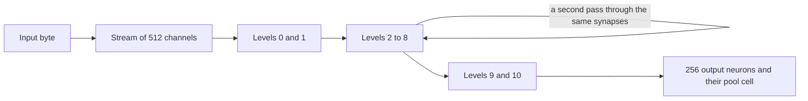

# Volley v20 model card

The checkpoint is a 36,263,956-parameter spike-only stack trained
from random weights for 368,640,000 byte targets. It is v19's
stack, v17's eleven levels with 128 knowledge cells in every read
head's race, trained on unbroken streams from 24,000 updates on at
a peak learning rate of 6e-4, with one change: every byte passes
its levels 2 to 8 twice, through the same synapses, so it runs 18
level passes on the synapses of 11. It reads a stream: its state is
carried from byte to byte, and a text of any length costs one step
per byte.

The weights are not in the repository. They are in the `fsp-loop`
archive of the release as `full_size_loop/fsp-loop/model.pt.averaged`,
the running average of the weights, which is what the study scores.
The file is 237 MB: its state dictionary names every pass of the
loop, so the synapses of levels 2 to 8 are stored twice, as
identical copies.
The model that runs from a clone is still
[v11](../spiking-byte-lm-v11/README.md).
[Study, measurements and limits](../../docs/SCALING_LAW.md) · [Checkpoint and archive hashes](manifest.json) · [Restore and rescore](../../docs/V20_HANDOFF.md)

**License:** AGPL-3.0-only, copyright 2026 control-f and Daniel Tremer; commercial licenses from control-f ([LICENSE](../../LICENSE), [NOTICE](../../NOTICE)).

**Behind by 0.025.** A Transformer of about the same size
(34,752,000 parameters), trained on the same data and windows at
its own best rate, 1.2e-3, reads the test in windows of 2,048
bytes. It is ahead of this checkpoint by 0.0249 bits per byte on
test (paired 95% interval 0.0238 to 0.0261) and by 0.0339 on
validation (0.0328 to 0.0351); with fast output synapses of its
own it is ahead by 0.0268 and 0.0342. The checkpoint is the best
spike-only stack so far: 0.0090 ahead of v19's on test (0.0084 to
0.0095) and 0.0086 on validation (0.0080 to 0.0092), where v19 was
0.0339 and 0.0425 behind the same Transformer
(`results/event_lm/knowledge_gap/full_size_loop_run.json`). It
fires 1.63 times v19's pulses a byte. Every score is one seed.

## Stack



A level is a state read of 8 heads, a race for 256 spikes over the
stream's stored cells and 128 ageless knowledge cells a head,
followed by 1,188 threshold cells and their pool cell, as in v17
(see its [model card](../spiking-byte-lm-v17/README.md)).
Every pass of a level in the loop keeps a tape of its own in a
stream, as a level of its own would, and the fast output synapses
hear the cells of all 18 passes. The loop adds no parameters.

| Part | Parameters |
|---|---:|
| 11 layers of threshold cells | 20,085,516 |
| 11 state reads, with 88 forgetting slopes | 14,463,240 |
| Knowledge cells, 128 in each of 88 heads | 1,453,056 |
| Input synapses | 131,072 |
| Output synapses | 131,072 |
| **Total** | **36,263,956** |

## Measured scope

The stack is scored on unbroken streams: an enwik8 split in 16
parts that run side by side, each after 8,192 unscored bytes of
the text before it. The Transformers carry no state. They read the
same texts in windows of their training length, scoring 16 bytes
in each window with the rest as history.

| Model | Peak rate | Parameters | enwik8 test | enwik8 validation |
|---|---:|---:|---:|---:|
| Transformer, windows of 2,048 bytes, with taught output synapses | 1.2e-3 | 34,752,000 | **1.0771** | **1.1044** |
| Transformer, windows of 2,048 bytes | 1.2e-3 | 34,752,000 | 1.0790 | 1.1048 |
| **This checkpoint, reaching 8,192 cells, with taught output synapses** | 6e-4 | 36,263,956 | **1.1039** | **1.1387** |
| This checkpoint, reaching 8,192 cells | 6e-4 | 36,263,956 | 1.1076 | 1.1404 |
| This checkpoint as trained | 6e-4 | 36,263,956 | 1.1260 | 1.1572 |
| v19's plain stack, the best reading | 6e-4 | 36,263,956 | 1.1129 | 1.1473 |
| v19's plain stack as trained | 6e-4 | 36,263,956 | 1.1302 | 1.1612 |

The reach of 8,192 cells was chosen on the first million
validation bytes (1.1685 there, against 1.1873 at the trained
2,048). Taught output synapses start at zero in every stream and
learn from each byte after it was predicted, at a threshold of
2^24 units of fast charge to a spike, on the cells of all 18
passes. Nothing takes a gradient on test text. Here they gain
0.0037 on test and 0.0018 on validation. The loop's gain over the
plain stack grows with the reach and the fast synapses: 0.0043 on
test as trained, 0.0070 at a reach of 8,192 and 0.0090 with fast
synapses.

## Where the gain is

Split byte by byte by what each byte's context offers, nine tenths
of the loop's gain is on new contexts, three quarters of the bytes:
there it is 0.0116 bits per byte better than v19's stack on test
and 0.0102 on validation. Against the Transformer the distance on
new contexts falls from 0.0895 to 0.0779 on test and from 0.0997
to 0.0895 on validation, while the stack stays far ahead wherever
the context offers a copy (0.081 near, 0.458 from 2 to 8 KB back).
Running levels twice with the same synapses adds knowledge at
equal parameters, as its pilot found after 24,000 updates, and the
gain holds after 90,000.

## Limits

- One seed at full size.
- The trainer counts about 510,000 pulses per byte against a
  budget of 507,000, 1.63 times v19's stack. That count is the
  trainer's own, and no native decoder has audited it.
- The looped stack's membranes sit at their bound more often than
  the plain stack's: 26.7% of the entries of its top cells and
  11.0% of its top read's, against 12.0% and 2.4%. The pool that
  lifts the ceiling, 0.0095 better for the loop in a full-size
  pilot, removes that bound and is not in this checkpoint.
- Training took 58,820 seconds on the trainer's clock against
  49,289 for v19's stack; the two runs shared their GPUs with
  different neighbours, so the ratio is rough.
- Not measured for this checkpoint: whole PG-19 books as single
  streams, a native integer run and a pulse audit.

## Rescore

```bash
python experiments/eval_stream.py --device cuda --enwik8 data/enwik8 --split test \
  --checkpoint checkpoints/full_size_loop/fsp-loop/model.pt.averaged \
  --reach 8192 --piece 256 --teach-levels 0 1 2 3 4 5 6 7 8 9 10 11 12 13 14 15 16 17 \
  --teach-threshold 16777216 --json checkpoints/work/fsp-loop.taught-test.json
```

Without the teaching flags the stack is scored without fast output
synapses, and without `--reach` as trained. `--device cpu` scores
on a CPU.

[Stack](../../snnformer/event_lm.py) · [Stream scorer](../../experiments/eval_stream.py) · [Scaling-law study](../../docs/SCALING_LAW.md) · [Roadmap](../../docs/ROADMAP.md)
