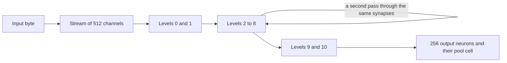

# Volley v21 model card

The checkpoint is a 36,263,956-parameter spike-only stack trained
from random weights for 368,640,000 byte targets. It is v20's
looped stack, eleven levels with 128 knowledge cells in every read
head's race, every byte passing levels 2 to 8 twice through the
same synapses, trained on unbroken streams from 24,000 updates on
at a peak learning rate of 6e-4, with one change: every
population's inhibitory pool lifts the membrane's ceiling
(`--pool-lifts-ceiling`). The pool divides a neuron's charge
before the membrane bounds it, so no membrane is held at its bound
and a neuron can fire up to its largest count at every threshold.
The lifting pool adds no parameters and no pulses. The model reads
a stream: its state is carried from byte to byte, and a text of any
length costs one step per byte.

The weights are not in the repository. They are in the `fsp-lift`
archive of the release as
`full_size_lifted_loop/fsp-lift/model.pt.averaged`, the running
average of the weights, which is what the study scores. The file
is 237 MB: its state dictionary names every pass of the loop, so
the synapses of levels 2 to 8 are stored twice, as identical
copies.
The model that runs from a clone is still
[v11](../spiking-byte-lm-v11/README.md).
[Study, measurements and limits](../../docs/SCALING_LAW.md) · [Checkpoint and archive hashes](manifest.json) · [Restore and rescore](../../docs/V21_HANDOFF.md)

**License:** AGPL-3.0-only, copyright 2026 control-f and Daniel Tremer; commercial licenses from control-f ([LICENSE](../../LICENSE), [NOTICE](../../NOTICE)).

**Behind by 0.003 on test and 0.009 on validation.** A Transformer
of about the same size (34,752,000 parameters), trained on the
same data and windows at its own best rate, 1.2e-3, reads the test
in windows of 2,048 bytes. It is ahead of this checkpoint by
0.0028 bits per byte on test (paired 95% interval 0.0017 to
0.0038) and by 0.0088 on validation (0.0077 to 0.0098); with fast
output synapses of its own it is ahead by 0.0046 and 0.0092. The
checkpoint does not beat it. It is the best spike-only stack so
far: 0.0222 ahead of v20's looped stack on test (0.0216 to 0.0228)
and 0.0251 on validation (0.0245 to 0.0257), where v20 was 0.0249
and 0.0339 behind the same Transformer
(`results/event_lm/knowledge_gap/full_size_lifted_loop_run.json`).
It fires v20's pulses a byte, 1.63 times the plain stack's. Every
score is one seed.

## Stack



A level is a state read of 8 heads, a race for 256 spikes over the
stream's stored cells and 128 ageless knowledge cells a head,
followed by 1,188 threshold cells and their pool cell, as in v17
(see its [model card](../spiking-byte-lm-v17/README.md)).
Every pass of a level in the loop keeps a tape of its own in a
stream, as a level of its own would, and the fast output synapses
hear the cells of all 18 passes. Under the lifting pool a
population's charge is divided by the pool's activity before it is
bounded, where v20 bounded it first.

| Part | Parameters |
|---|---:|
| 11 layers of threshold cells | 20,085,516 |
| 11 state reads, with 88 forgetting slopes | 14,463,240 |
| Knowledge cells, 128 in each of 88 heads | 1,453,056 |
| Input synapses | 131,072 |
| Output synapses | 131,072 |
| **Total** | **36,263,956** |

## Measured scope

The stack is scored on unbroken streams: an enwik8 split in 16
parts that run side by side, each after 8,192 unscored bytes of
the text before it. The Transformers carry no state. They read the
same texts in windows of their training length, scoring 16 bytes
in each window with the rest as history.

| Model | Peak rate | Parameters | enwik8 test | enwik8 validation |
|---|---:|---:|---:|---:|
| Transformer, windows of 2,048 bytes, with taught output synapses | 1.2e-3 | 34,752,000 | **1.0771** | **1.1044** |
| Transformer, windows of 2,048 bytes | 1.2e-3 | 34,752,000 | 1.0790 | 1.1048 |
| **This checkpoint, reaching 8,192 cells, with taught output synapses** | 6e-4 | 36,263,956 | **1.0817** | 1.1136 |
| This checkpoint, reaching 8,192 cells | 6e-4 | 36,263,956 | 1.0827 | **1.1128** |
| This checkpoint as trained | 6e-4 | 36,263,956 | 1.0983 | 1.1276 |
| v20's looped stack, the best reading | 6e-4 | 36,263,956 | 1.1039 | 1.1387 |
| v19's plain stack, the best reading | 6e-4 | 36,263,956 | 1.1129 | 1.1473 |

The reach of 8,192 cells was chosen on the first million
validation bytes (1.1401 there, against 1.1561 at the trained
2,048). Taught output synapses start at zero in every stream and
learn from each byte after it was predicted, at a threshold of
2^24 units of fast charge to a spike, on the cells of all 18
passes. Nothing takes a gradient on test text. The registered
reading is the one with them. Here they add little: 0.0009 on
test, and on validation they cost 0.0007, so the checkpoint's best
validation score is the one without them, 0.0080 behind the
Transformer. On v20's stack they added 0.0037 and 0.0017.

## Where the gain is

Split byte by byte by what each byte's context offers, the lifting
pool's gain is knowledge. On new contexts, three quarters of the
bytes, the checkpoint is 0.0340 bits per byte better than v20's
looped stack on test and 0.0371 on validation, more than its whole
gain. Against the Transformer the distance on new contexts falls
from 0.0779 to 0.0439 on test and from 0.0895 to 0.0524 on
validation, while the stack stays far ahead wherever the context
offers a copy (0.087 near on both splits, 0.438 and 0.401 from 2
to 8 KB back). It pays for part of that where the eight bytes
before a byte ran earlier and another byte followed them, about 5%
of the bytes: there it is 0.057 and 0.098 worse than v20's stack.
The pilot's gain after 24,000 updates on windows was 0.0095, so
the lifting pool's gain did not fade with length: it more than
doubled.

## Limits

- One seed at full size.
- The trainer counts 506,746 pulses per byte on its validation
  streams against a budget of 507,000, 1.63 times the plain
  stack's. That count is the trainer's own, and no native decoder
  has audited it.
- No membrane sits at a bound: 0.036% of the entries of the top
  cells reach their largest count, against 26.7% of v20's at the
  membrane's bound. The two shares count different events, the cap
  of a count here and the bound of a charge there.
- Fast output synapses at 2^24 cost 0.0007 on validation. Their
  threshold was scanned on v20's stack, not on this one.
- Training took 58,820 seconds on the trainer's clock, as v20's
  did: the lifting pool costs no training time. With the fused
  race kernels released beside this checkpoint a stream update
  takes 0.18 s for 0.81 s, which puts the same recipe under five
  hours of training; this checkpoint was trained without them.
- Not measured for this checkpoint: whole PG-19 books as single
  streams, a native integer run and a pulse audit.

## Rescore

```bash
python experiments/eval_stream.py --device cuda --enwik8 data/enwik8 --split test \
  --checkpoint checkpoints/full_size_lifted_loop/fsp-lift/model.pt.averaged \
  --reach 8192 --piece 256 --teach-levels 0 1 2 3 4 5 6 7 8 9 10 11 12 13 14 15 16 17 \
  --teach-threshold 16777216 --json checkpoints/work/fsp-lift.taught-test.json
```

Without the teaching flags the stack is scored without fast output
synapses, and without `--reach` as trained. `--device cpu` scores
on a CPU.

[Stack](../../snnformer/event_lm.py) · [Stream scorer](../../experiments/eval_stream.py) · [Scaling-law study](../../docs/SCALING_LAW.md) · [Roadmap](../../docs/ROADMAP.md)
