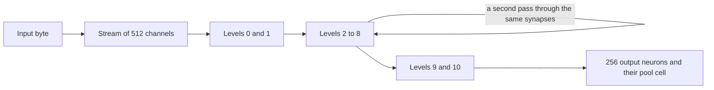

# Volley v22 model card

The checkpoint is a 36,263,956-parameter spike-only stack trained
from random weights for 368,640,000 byte targets. It is v21's
lifted loop, eleven levels with 128 knowledge cells in every read
head's race, every byte passing levels 2 to 8 twice through the
same synapses under the pool that lifts the membrane's ceiling,
trained on unbroken streams from 24,000 updates on at a peak
learning rate of 6e-4, with one change: its threshold cells are
power-law cells (`--granule-power 8`). A power-law cell fires
round(k * k / 8) spikes for k thresholds of charge, up to its cap,
as a cortical neuron's rate grows with about the square of how far
its membrane stands past threshold. The change adds no parameters.
The model reads a stream: its state is carried from byte to byte,
and a text of any length costs one step per byte.

The weights are not in the repository. They are in the `fsp-lift2`
archive of the release as
`full_size_lifted_loop/fsp-lift2/model.pt.averaged`, the running
average of the weights, which is what the study scores. The file
is 237 MB: its state dictionary names every pass of the loop, so
the synapses of levels 2 to 8 are stored twice, as identical
copies.
The model that runs from a clone is still
[v11](../spiking-byte-lm-v11/README.md).
[Study, measurements and limits](../../docs/SCALING_LAW.md) · [Checkpoint and archive hashes](manifest.json) · [Restore and rescore](../../docs/V22_HANDOFF.md)

**License:** AGPL-3.0-only, copyright 2026 control-f and Daniel Tremer; commercial licenses from control-f ([LICENSE](../../LICENSE), [NOTICE](../../NOTICE)).

**Read as registered, it is behind; read without fast output
synapses, it is ahead on test and level on validation.** The
record read the stack, as every full-size stack since v19, with
fast output synapses that learn from each byte after it was
predicted (`results/event_lm/knowledge_gap/full_size_lifted_loop_second.json`).
Read that way the checkpoint is 0.0055 bits per byte behind a
Transformer of about the same size (34,752,000 parameters) trained
on the same data at its own best rate on test (paired 95% interval
0.0044 to 0.0066) and 0.0121 behind on validation, and 0.0027 and
0.0034 behind v21's stack. Here the fast output synapses cost
0.0092 on test and 0.0115 on validation. Read without them, at a
reach of 8,192 cells, the checkpoint scores 1.0752 on test and
1.1054 on validation. Then it is 0.0038 ahead of the Transformer on
test (0.0027 to 0.0047), with neither model using fast synapses,
and 0.0006 behind it on validation (0.0004 ahead to 0.0016 behind),
and 0.0074 ahead of v21's stack read the same way on both splits.
That measure was chosen after the scores were seen, so it is
reported and not claimed. A second seed of this recipe, read
without fast output synapses as fixed in advance, is training
(`full_size_power_cells_second_seed.json`). Every score is one
seed, and the Transformer is one seed too.

## Stack



A level is a state read of 8 heads, a race for 256 spikes over the
stream's stored cells and 128 ageless knowledge cells a head,
followed by 1,188 power-law threshold cells and their pool cell
(v21's [model card](../spiking-byte-lm-v21/README.md) describes the
rest). Every pass of a level in the loop keeps a tape of its own in
a stream, and every population's pool divides a neuron's charge
before its membrane bounds it.

| Part | Parameters |
|---|---:|
| 11 layers of threshold cells | 20,085,516 |
| 11 state reads, with 88 forgetting slopes | 14,463,240 |
| Knowledge cells, 128 in each of 88 heads | 1,453,056 |
| Input synapses | 131,072 |
| Output synapses | 131,072 |
| **Total** | **36,263,956** |

## Measured scope

The stack is scored on unbroken streams: an enwik8 split in 16
parts that run side by side, each after 8,192 unscored bytes of
the text before it. The Transformers carry no state. They read the
same texts in windows of their training length, scoring 16 bytes
in each window with the rest as history.

| Model | Peak rate | Parameters | enwik8 test | enwik8 validation |
|---|---:|---:|---:|---:|
| **This checkpoint, reaching 8,192 cells** | 6e-4 | 36,263,956 | **1.0752** | 1.1054 |
| Transformer, windows of 2,048 bytes, with taught output synapses | 1.2e-3 | 34,752,000 | 1.0771 | **1.1044** |
| Transformer, windows of 2,048 bytes | 1.2e-3 | 34,752,000 | 1.0790 | 1.1048 |
| v21's lifted loop, reaching 8,192 cells, with taught output synapses | 6e-4 | 36,263,956 | 1.0817 | 1.1136 |
| v21's lifted loop, reaching 8,192 cells | 6e-4 | 36,263,956 | 1.0827 | 1.1128 |
| This checkpoint, reaching 8,192 cells, with taught output synapses (the registered reading) | 6e-4 | 36,263,956 | 1.0845 | 1.1169 |
| This checkpoint as trained | 6e-4 | 36,263,956 | 1.0902 | 1.1193 |

The reach of 8,192 cells was chosen on the first million
validation bytes (1.1327 there, against 1.1483 at the trained
2,048). Taught output synapses start at zero in every stream and
learn from each byte after it was predicted, at a threshold of
2^24 units of fast charge to a spike, on the cells of all 18
passes. Nothing takes a gradient on test text. Their threshold was
scanned on v20's stack of plain cells; on this one they help copies
(0.045 on near copies, 0.023 on far ones on test) and cost new
contexts 0.026 to 0.028, more than they gain.

## Where the gain is

Read without fast output synapses, the power-law cells are 0.0074
better than v21's plain cells on both splits (interval 0.0069 to
0.0080), and 0.0081 and 0.0083 better as trained. The gain lies on
new contexts, three quarters of the bytes: 0.0097 on test and 0.0140
on validation. Against the Transformer the distance on new contexts
falls to 0.0262 on test and 0.0293 on validation (v21: 0.0439 and
0.0524), and the stack stays far ahead wherever the context offers a
copy (0.058 near and 0.425 from 2 to 8 KB back on test). On the
test bed power-law cells led by 0.0125 on the mean of four seeds,
and in a full-size pilot by 0.0137: the gain carried to full length.
At every level 0.50 to 0.72 times as many cells fire at a byte as
in v21's stack, with a longer tail of spikes from the cells that do.

## Limits

- One seed at full size, of the stack and of the Transformer. How
  far two seeds of one recipe lie apart at full size is not known;
  the second seed measures it.
- The win on test is on a measure chosen after the scores were
  seen. On validation the stack is level with the Transformer, not
  ahead.
- The trainer counts 506,607 pulses per byte on its validation
  streams against a budget of 507,000, 1.63 times the plain
  stack's. That count is the trainer's own, and no native decoder
  has audited it.
- Saturation is negligible: 0.000001% of the cells' entries reach
  their cap, 0.010% of the reads'.
- Training took 59,238 seconds on the trainer's clock, 0.7% more
  than v21's stack, without the fused race kernels.
- Not measured for this checkpoint: whole PG-19 books as single
  streams, a native integer run and a pulse audit.

## Rescore

```bash
python experiments/eval_stream.py --device cuda --enwik8 data/enwik8 --split test \
  --checkpoint checkpoints/full_size_lifted_loop/fsp-lift2/model.pt.averaged \
  --reach 8192 --piece 256 --json checkpoints/work/fsp-lift2.reach-test.json
```

With `--teach-levels 0 1 2 3 4 5 6 7 8 9 10 11 12 13 14 15 16 17
--teach-threshold 16777216` the stack is scored with fast output
synapses, the registered reading, and without `--reach` as trained.
`--device cpu` scores on a CPU.

[Stack](../../snnformer/event_lm.py) · [Stream scorer](../../experiments/eval_stream.py) · [Scaling-law study](../../docs/SCALING_LAW.md) · [Roadmap](../../docs/ROADMAP.md)
