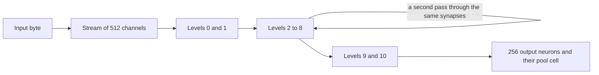

# Volley v23 model card

The checkpoint is a 36,263,956-parameter spike-only stack trained
from random weights for 368,640,000 byte targets. It is the second
seed (20002) of v22's recipe: v21's lifted loop, eleven levels with
128 knowledge cells in every read head's race, every byte passing
levels 2 to 8 twice through the same synapses under the pool that
lifts the membrane's ceiling, with power-law threshold cells
(`--granule-power 8`), trained on unbroken streams from 24,000
updates on at a peak learning rate of 6e-4. Only the seed and the
speed of training changed: it trained on the fused race kernels
(`--fused-reads --fused-optimizer --exact-products`), in 17,949
seconds against the first seed's 59,238. The model reads a stream:
its state is carried from byte to byte, and a text of any length
costs one step per byte.

The weights are not in the repository. They are in the
`fsp-lift2-s2` archive of the release as
`full_size_lifted_loop/fsp-lift2-s2/model.pt.averaged`, the running
average of the weights, which is what the study scores. Its state
dictionary names every pass of the loop, so the synapses of levels
2 to 8 are stored twice, as identical copies.
The model that runs from a clone is still
[v11](../spiking-byte-lm-v11/README.md).
[Study, measurements and limits](../../docs/KNOWLEDGE_GAP.md) · [Checkpoint and archive hashes](manifest.json) · [Restore and rescore](../../docs/V23_HANDOFF.md)

**License:** AGPL-3.0-only, copyright 2026 control-f and Daniel Tremer; commercial licenses from control-f ([LICENSE](../../LICENSE), [NOTICE](../../NOTICE)).

**Ahead of the Transformer on test, level on validation, with two
seeds alike. By the rule fixed in advance that is not a win.** The
record (`results/event_lm/knowledge_gap/full_size_power_cells_second_seed.json`)
fixed the measure before this run: the stack without fast output
synapses, at the reach chosen on the first million validation
bytes, against the Transformer's frozen score, paired piece by
piece. The checkpoint scores 1.0751 bits per byte on the enwik8
test and 1.1051 on validation. Against a Transformer of about the
same size (34,752,000 parameters) trained on the same data at its
own best rate, it is 0.0039 ahead on test (paired 95% interval
0.0029 to 0.0048) and 0.0003 behind on validation (0.0007 ahead to
0.0013 behind). The record asked for both intervals below zero, so
the stack does not beat the Transformer by it. The two seeds' mean
reads the same: 0.0038 ahead on test, 0.0004 behind on validation.
The seeds lie 0.0001 apart on test and 0.0003 on validation.

## Stack



The stack is v22's ([model card](../spiking-byte-lm-v22/README.md)).

| Part | Parameters |
|---|---:|
| 11 layers of threshold cells | 20,085,516 |
| 11 state reads, with 88 forgetting slopes | 14,463,240 |
| Knowledge cells, 128 in each of 88 heads | 1,453,056 |
| Input synapses | 131,072 |
| Output synapses | 131,072 |
| **Total** | **36,263,956** |

## Measured scope

The stack is scored on unbroken streams: an enwik8 split in 16
parts that run side by side, each after 8,192 unscored bytes of
the text before it. The Transformers carry no state. They read the
same texts in windows of their training length, scoring 16 bytes
in each window with the rest as history.

| Model | Peak rate | Parameters | enwik8 test | enwik8 validation |
|---|---:|---:|---:|---:|
| **This checkpoint, reaching 8,192 cells (the registered reading)** | 6e-4 | 36,263,956 | **1.0751** | 1.1051 |
| v22's checkpoint (seed 20001), reaching 8,192 cells | 6e-4 | 36,263,956 | 1.0752 | 1.1054 |
| Transformer, windows of 2,048 bytes, with taught output synapses | 1.2e-3 | 34,752,000 | 1.0771 | **1.1044** |
| Transformer, windows of 2,048 bytes (the registered comparison) | 1.2e-3 | 34,752,000 | 1.0790 | 1.1048 |
| This checkpoint, reaching 8,192 cells, with taught output synapses | 6e-4 | 36,263,956 | 1.0849 | 1.1170 |
| This checkpoint as trained (reach 2,048) | 6e-4 | 36,263,956 | 1.0888 | 1.1177 |

The reach of 8,192 cells was chosen on the first million
validation bytes (1.1309 there, against 1.1447 at the trained
2,048). Taught output synapses start at zero in every stream and
learn from each byte after it was predicted, at 2^24 units of fast
charge to a spike, on the cells of all 18 passes. On this stack
they cost 0.0097 on test and 0.0119 on validation (they help
copies and bytes seen before by 0.02 to 0.08 a byte and cost new
contexts 0.028), as they cost the first seed. By the record, stacks with power-law cells are
read without them from here on, and a scan of their threshold on
both seeds is registered (`fast_synapse_threshold_power.json`).

## Where it stands against the Transformer

Split by what the context offers (`experiments/gap_by_piece.py`),
the stack is ahead wherever a copy is on offer and behind on new
contexts:

| Context (test / validation) | Share of bytes | Stack minus Transformer, bits a byte |
|---|---|---|
| Copyable from the last 2 KB | 16.6% / 13.5% | -0.054 / -0.070 |
| Copyable only from 2 to 8 KB back | 4.2% / 4.3% | -0.40 / -0.38 |
| Seen, another byte followed | 5.5% / 5.4% | +0.062 / +0.060 |
| New context | 73.7% / 76.8% | +0.025 / +0.030 |

Validation holds fewer copyable bytes than test, which is why the
same model is ahead on one split and level on the other. What is
left between the stack and a win on both is knowledge on new
contexts.

## Limits

- Two seeds of the stack, one of the Transformer. The Transformer's
  spread between seeds is not measured.
- The trainer counts 507,237 pulses per byte at the last update
  against a budget of 507,000, 1.63 times the plain stack's. That
  count is the trainer's own, and no native decoder has audited it.
- Saturation is negligible (7e-8 of the cells' entries reach their
  cap, 8e-5 of the reads'), and the cells fire as the first seed's
  (20,650 cell spikes a byte against 20,675; the record's
  `result_measurements`).
- Not measured for this checkpoint: whole PG-19 books as single
  streams, a native integer run and a pulse audit.

## Rescore

```bash
python experiments/eval_stream.py --device cuda --enwik8 data/enwik8 --split test \
  --checkpoint checkpoints/full_size_lifted_loop/fsp-lift2-s2/model.pt.averaged \
  --reach 8192 --piece 256 --json checkpoints/work/fsp-lift2-s2.reach-test.json
```

With `--teach-levels 0 1 2 3 4 5 6 7 8 9 10 11 12 13 14 15 16 17
--teach-threshold 16777216` the stack is scored with fast output
synapses, and without `--reach` as trained. `--device cpu` scores
on a CPU.

[Stack](../../snnformer/event_lm.py) · [Stream scorer](../../experiments/eval_stream.py) · [Knowledge-gap study](../../docs/KNOWLEDGE_GAP.md) · [Roadmap](../../docs/ROADMAP.md)
