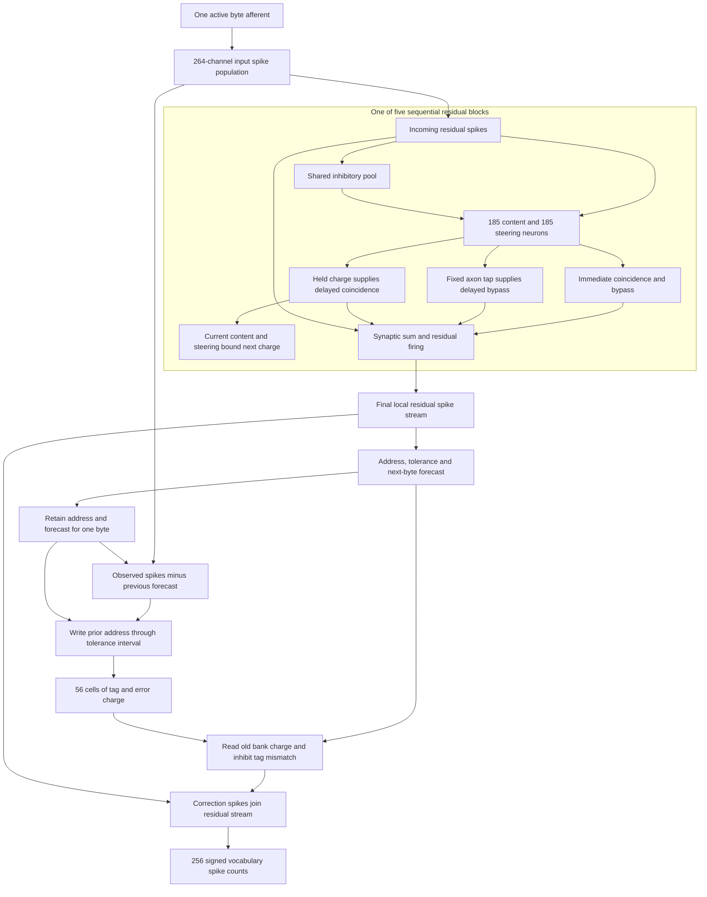

# ShuntFormer v3 model card

This checkpoint continues the five-block v2 spiking decoder on
2,048-byte enwik8 windows. It retains 1,630,992 parameters and
21,320 bytes of persistent tensor state per stream. The continuation
uses a chronological gradient rule for the held-charge cells.
[Weights](weights.pt) · [Full configuration and SHA-256](manifest.json)

## Architecture



- **Pulse routing.** Signed content $p$ and nonnegative steering $s$
  send $\operatorname{sgn}(p)\min(|p|,s)$ to the coincident path.
  The remaining pulses take the bypass. The immediate paths use
  current content. The delayed bypass uses a fixed axon tap, and
  the delayed coincidence uses the held charge entering this byte.
  Each of the four paths has its own learned projection into the
  residual population.
- **Shared inhibition.** Each incoming pulse contributes one charge
  tick to a pool with threshold 2,048 ticks. When the pool emits
  $h$ pulses, content and steering both fire at $64+16h$ ticks.
  The pool has zero learned parameters and resets each byte.
- **Local held charge.** Each expansion channel stores $m_t$.
  Steering opens a read of $\operatorname{sgn}(m_t)\min(|m_t|,s_t)$.
  The write emits only the signed change needed to move $m_t$ into
  $[p_t-s_t,p_t+s_t]$, bounded by the firing cap. Successive
  intervals can preserve the same charge across many bytes.
- **Verified correction memory.** Four heads each select a cell by
  spike-count competition over 14 candidates. A cell holds two
  context-tag coordinates and six signed error coordinates. Its
  previous address receives the forecast tag and a tolerance-bound
  update toward the observed minus forecast input code. In parallel,
  the current address reads the **pre-write** charge. The largest tag
  mismatch beyond the read tolerance emits inhibitory spikes that
  cancel overlapping payload pulses. One vocabulary population
  consumes the surviving correction and local spikes.

The model uses 16× count resolution, signed six-fractional-bit
synapses, and reset-per-byte firing phases. Fixed delays reach 49
preceding bytes. Local held charge and the forecast-error bank can
persist across evaluation chunks. Recall at any given distance
depends on charge retention, address collisions, and tag agreement.
[Decoder](../../snnformer/event_lm.py) · [Charge updates and training scan](../../snnformer/correction_memory.py)

| Persistent state | Bytes per stream |
|---|---:|
| Compact axon rings with delays [1, 1, 2, 3], [1, 2, 4, 8], [1, 3, 9, 27], [1, 1, 2, 3], [1, 2, 4, 8] | 15,476 |
| Local held charge, 5 × 185 cells | 3,700 |
| Forecast-error and tag charge, 4 × 14 × 8 coordinates | 1,792 |
| Previous address | 224 |
| Previous tag and forecast | 128 |
| **Total, Int32 tensors** | **21,320** |

The state tally covers persistent tensors. Weights, temporary
workspace, and the Python byte index are separate. Training uses
FP32 master weights and surrogate gradients through the quantized
forward pass. The integer CPU path accumulates fixed-point charge
and produces signed vocabulary spikes. Cross-entropy and the
optional PG-19 temperature operate on scaled output counts.
[Detailed ring layout](../spiking-byte-lm-v2/README.md#state-and-arithmetic)

## Training and results

The seed-0 v2 parent saw 26,214,400 enwik8 targets. The seed-711
continuation added 6,553,600 targets in 1,600 AdamW steps with two
2,048-byte windows per batch, 64 warmup steps, a peak learning rate
of 0.0004, weight decay of 0.05, and a cosine schedule. The loss
includes next-byte cross-entropy, a 0.25-weighted forecast-code loss,
and a pulse-price term targeting 310,000 emissions per byte.
`--trace-write-credit` sends future gradients to the last bound
that moved a cell. At inference the forward charge rule is the
same as v2.
[Training record](../../results/event_lm/long_context_continuation/event_correction_code_s711_ctx2048_continuation.json) · [Write credit](../../docs/TRACE_WRITE_CREDIT.md)

| Seed-711 2,048-byte continuation | enwik8 bpb | PG-19 bpb | PG-19 raw bpb |
|---|---:|---:|---:|
| ShuntFormer v3 | 1.98884 | **2.96180** | **3.07240** |
| Full-attention Transformer | **1.81712** | 3.11395 | 3.33558 |

The PG-19 comparison covers 16 complete books, with temperatures
fitted on eight separate books. The SNN scores lower on all 16.
The Transformer has lower loss on the complete enwik8 test split.
Native CPU vocabulary counts match the MPS forward pass and native
chunked outputs on 4,096 enwik8 test bytes. The first 513 bytes
also match single-byte decoding. The sample averages 304,447 counted
pulses per byte. Those counts describe circuit activity in PyTorch.
[Evaluation and protocol](../../docs/CONTEXT_LENGTH.md#train-the-longer-context) · [Integer audit](../../results/event_lm/long_context_continuation/native_trace_ctx2048_s711.json)

## Continue working

```bash
python experiments/generate_event_lm.py models/spiking-byte-lm-v3/weights.pt \
  --prompt 'The first chapter' --bytes 128 > continuation.bin
```

The handoff includes exact replay and scoring commands and the
training checkpoints for the original held-charge control,
opponent steering, read veto, and spread coincidence.
[Research handoff](../../docs/HANDOFF.md) · [Leaderboards](../../docs/LEADERBOARD.md)
