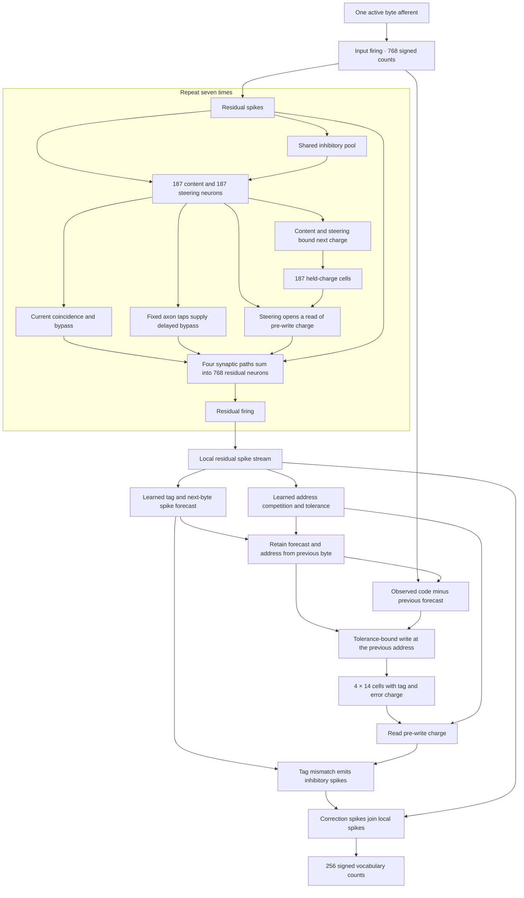

# ShuntFormer v4 model card

The bundled checkpoint is the 6,514,176-parameter continuation of the
trained seven-block, 3.26M held-charge SNN. The residual stream grew
from 384 to 768 neurons. Each block still has 187 content neurons and
187 steering neurons. The router uses eight fractional charge bits.
Every learned link in the CPU decoder consumes spike counts and
accumulates integer synaptic charge. One byte step emits 256 signed
vocabulary spike counts.
[Weights](weights.pt) · [Exact configuration and digests](manifest.json)

## Architecture

### Firing and routing

- **Shared inhibition.** Each incoming pulse adds one tick to the
  pool, which has a 2,048-tick threshold. If it emits $h$ pulses, the
  content and steering thresholds are $256+64h$ router ticks. The pool uses
  the expansion population sizes to set its threshold, which preserves
  the initial firing rule as residual width grows.
- **Four paths per block.** Current content $p$ and nonnegative
  steering $s$ send `sign(p) × min(abs(p), s)` to the immediate
  coincidence path. The rest takes the immediate bypass. The fixed
  axon tap supplies the unmatched delayed pulses. The delayed
  coincidence path uses the signed read of the charge $m$ entering
  the byte, `sign(m) × min(abs(m), s)`. Each path has its own
  synaptic weights. Their projected charge sums with the direct
  residual before firing.
- **Held charge.** For each expansion neuron, the next charge is the
  previous charge clipped to the current content interval
  `[p - s, p + s]` within the firing cap. The clipped difference
  gives the signed write pulses. An unchanged charge can survive
  any number of bytes while each subsequent interval contains it.
- **Verified correction bank.** Four heads each select one of 14
  addresses by spike-count competition. Two of the eight coordinates
  in a cell hold the forecast's learned context tag. The other six
  hold a tolerance-bound error between observed and previously
  forecast spike codes. The present address reads pre-write charge
  while the previous address takes the new error. The maximum tag
  mismatch beyond tolerance emits inhibitory spikes that cancel
  overlapping payload pulses. Surviving correction pulses project
  back into the same vocabulary pathway.

The router synapses have spacing $1/256$. The input, correction, and
vocabulary synapses use $1/64$. Firing-count resolution is 16×. Hidden
firing phases reset at each byte. The axons, held charge, and correction
cells carry state across bytes. The fixed taps span up to 79 previous
bytes through the seven blocks. Recall beyond that depends on the
stored charge and tag agreement.
[Integer decoder](../../snnformer/event_lm.py) ·
[Interval and write rules](../../snnformer/correction_memory.py) ·
[Function-preserving initialization](../../docs/GROWN_RESIDUAL.md)

### Measured persistent state

| Component | Storage per stream |
|---|---:|
| Delay rings, signed Int16 | 12,156 B |
| Local held charge, 7 × 187 signed Int32 cells | 5,236 B |
| Error and tag charge, 4 × 14 × 8 signed Int32 coordinates | 1,792 B |
| Previous address, 4 × 14 Int32 counts | 224 B |
| Previous forecast, 4 × 8 signed Int32 counts | 128 B |
| **Total** | **19,536 B** |

Each block splits the 187 content channels into groups of 47, 47,
47, and 46. Tap patterns cycle through `[1, 1, 2, 3]`,
`[1, 2, 4, 8]`, and `[1, 3, 9, 27]`. Each ring stores only
the history needed at its own tap. The total excludes weights,
temporary workspace, and the Python byte index.
[Native audit](../../results/event_lm/grown_fine_charge/native_fine_s711.json)

## Training and verification

The 3.26M parent saw 26,214,400 enwik8 targets. The widening
initializer copies the existing synapses, zeros the synapses that
produce newly added residual counts, and keeps the outgoing weights
from those neurons trainable. Existing router weights are put exactly
on the trained six-bit grid. The finer representation then lets the
weights move in quarter-size steps. The parent's counts and total
emissions matched exactly on a 4,096-byte enwik8 validation sample
before the first update.

The continuation used seed 711, 1,600 AdamW steps with eight
512-byte windows per step, 64 warmup steps, a peak learning rate
of 0.0004, weight decay of 0.05, and a cosine schedule. Training uses
FP32 master weights and surrogate gradients through the quantized
forward pass. Its objective combines next-byte loss, a 0.25-weighted
next-code forecast loss on the payload coordinates, and a pulse
penalty targeting 310,000 emissions per byte.
[Parent and training record](../../results/event_lm/grown_fine_charge/event_correction_code_s711_scale_6510k_grown_fine_charge.json) ·
[Warm-start parity](../../results/event_lm/grown_fine_charge/warm_fine_charge.json)

The trained checkpoint emitted 309,505 pulses per byte on the
4,096-byte native enwik8 test audit. All vocabulary counts matched
the Metal path and integer chunked execution. The first 513 byte
steps also matched the native single-stream decoder. Probability
scoring multiplies signed counts by $\ln(2)/(8 \times 16)$ before
applying the optional PG-19 temperature.
Greedy generation selects the winning count directly.
[Training and scoring commands](../../docs/HANDOFF.md) ·
[Matched results and raw PG-19 scores](../../docs/LEADERBOARD.md)
