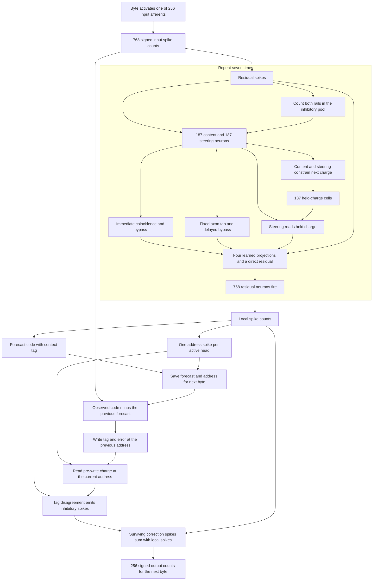

# ShuntFormer v5 model card

The bundled checkpoint is the six-bit, seven-block SNN trained on
**65,536,000 enwik8 targets**. It has **6,514,176 learned parameters**
and **19,536 bytes of persistent tensor state** per stream. Use it
as the parent for the next width study. The checkpoint stores the
trainable weights. The CPU generation script quantizes them once and
decodes each byte with integer synaptic charge and signed spike counts.
[Weights](weights.pt) · [Architecture flags and SHA-256](manifest.json) ·
[Run and reproduce](../../docs/HANDOFF.md)

## Architecture

**Firing and routing.** Learned synapses accumulate signed integer
charge. With six fractional bits the router's resting threshold is 64
ticks. The block's shared pool receives the absolute counts on both
input rails. It fires at a threshold of 2,048 ticks. If the pool emits
$h$ pulses, the content and steering threshold becomes $64+16h$ ticks.
The pool threshold is set by expansion size, so residual widening
can preserve the initial firing rule.

For signed content $p$ and nonnegative steering $s$, immediate
coincidence emits $\operatorname{sign}(p)\min(|p|,s)$. The remaining
content takes the immediate bypass. The matching fixed axon supplies
its unmatched delayed pulses to the delayed bypass. Pre-write held
charge $m$ supplies $\operatorname{sign}(m)\min(|m|,s)$ to the fourth
projection. The charge for the next byte is $m$ clipped to the
intersection of $[p-s,p+s]$ and the firing range. This lets a byte's
steering pulses read stored charge and control the width of the next
write interval. A charge persists across as many bytes as continue
to admit it in their intervals.

**Verified correction.** Four heads use learned spike-count
competition to address up to one of 14 cells each. A cell has two tag
coordinates and six payload coordinates. On each byte, the previous
address receives the saved forecast tag and the forecast error derived
from the observed input code. The tag takes a zero-width write
interval and the payload uses the learned tolerance. The current
address reads pre-write charge. A tag coordinate's distance outside
the current forecast's tolerance interval produces inhibitory pulses.
The maximum excess across the two coordinates cancels coincident
payload pulses before they can affect the next-byte counts. This
uses a single tolerance rule to bound what is written and verify what
is read. It is a finite learned memory with overlapping addresses,
and access depends on the learned tags and the charge still held.
[Integer implementation](../../snnformer/event_lm.py) ·
[Causal interval update](../../snnformer/correction_memory.py)

## Persistent state

| Tensor | Per stream |
|---|---:|
| Fixed-delay rings, signed Int16 | 12,156 B |
| Held charge, 7 × 187 signed Int32 cells | 5,236 B |
| Error and tag charge, 4 × 14 × 8 signed Int32 coordinates | 1,792 B |
| Previous address, 4 × 14 Int32 counts | 224 B |
| Previous forecast, 4 × 8 signed Int32 counts | 128 B |
| **Total** | **19,536 B** |

Each block partitions its 187 content channels into groups of 47,
47, 47, and 46. Tap patterns cycle through `[1, 1, 2, 3]`,
`[1, 2, 4, 8]`, and `[1, 3, 9, 27]`. The fixed taps span up to 79
previous bytes over seven blocks. Each ring stores just its tap's
history. Neuron phases reset every byte. Only the tensors above and
the byte index pass to the next step. The state budget stays fixed
as the stream grows, and the model's own recall still depends on
what its finite charge stores retain.

## Training and verification

The checkpoint continues the 49,152,000-target six-bit parent for
4,000 AdamW steps, each with eight 512-byte windows sampled from the
training split. It uses seed 2503, 128 warmup steps, a peak learning
rate of 0.0003, and weight decay of 0.05. Training updates FP32 master
weights through a quantized forward pass with surrogate gradients.
The objective combines next-byte cross-entropy, a 0.25-weighted
next-code forecast loss, and a pulse penalty targeting 310,000
emissions per byte. For probability scoring, signed output counts
are scaled by $\ln(2)/(8\times16)$ before any corpus calibration.
Greedy generation uses the winning count directly.

The reference emitted **308,230 pulses per byte** in the native
4,096-byte enwik8 test audit. All vocabulary counts agreed with
Metal and with native chunk decoding. The first 513 bytes also
matched the integer single-byte path.
[Exact training record](../../results/event_lm/scale_6510k_next_data/event_correction_code_s2503_scale_6510k_65536k_targets.json) ·
[Native parity and pulse profile](../../results/event_lm/scale_6510k_next_data/native_trace_s2503.json) ·
[Matched held-out results](../../docs/LEADERBOARD.md)

## Related checkpoints in this release

| Arm | Design change |
|---|---|
| [Expanded content and steering](../../docs/EXPANSION_GROWTH.md) | 256 channels in each population. A right-hand surrogate gradient wakes added steering neurons from a silent initialization. |
| [Delayed write confirmation](../../docs/TRACE_WRITE_CONFIRM.md) | Arriving axon spikes widen the held-charge write interval on the side of disagreement. |
| [Redistribution of inhibition](../../docs/INHIBITION_REDISTRIBUTION.md) | Learned relays transfer inhibitory pulses between delay groups while conserving the paired totals. |
| [Frozen teacher guidance](../../docs/TEACHER_GUIDANCE.md) | Extra supervision during training. The exported model runs the SNN described above. |
| [v4 finer charge](../spiking-byte-lm-v4/README.md) | Eight fractional router bits with the same firing-count resolution. |

## License

Licensed under the GNU Affero General Public License, version 3 only (AGPL-3.0-only), copyright 2026 control-f and Daniel Tremer; commercial licenses without the AGPL's conditions are available from control-f. See the repository's [LICENSE](../../LICENSE) and [NOTICE](../../NOTICE).
