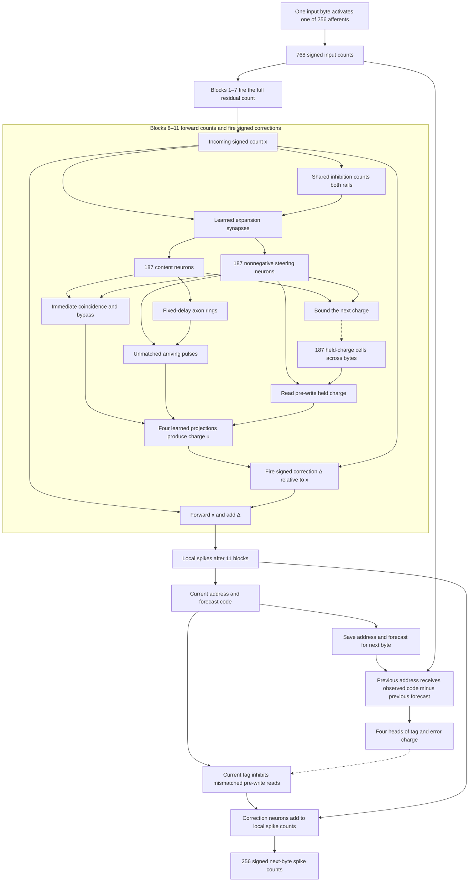

# ShuntFormer v6 model card

The bundled checkpoint is the 11-block signed-correction SNN. It has
**9,960,960 parameters** and **29,674 bytes of persistent tensor state**
per stream. It was trained on 81,920,000 cumulative enwik8 next-byte
targets. This checkpoint is the reference for further depth work.
[Weights](weights.pt) · [Exact configuration and SHA-256](manifest.json) ·
[Training handoff](../../docs/HANDOFF.md) · [Matched results](../../docs/DEPTH_GROWTH.md)

## Circuit

### Spike arithmetic

The first seven blocks retain their parent's circuit. All eleven
expand 768 channels into 187 signed content neurons and 187
nonnegative steering neurons. Byte afferents, the correction bank,
and the vocabulary readout use six fractional synapse bits. The
local block synapses use eight, with resting threshold
$\theta=256$ charge ticks. The shared pool integrates absolute input
counts on both rails with threshold 2,048. Its $h$ pulses raise the
content and steering thresholds to $256+64h$. The firing count
resolution is 16 throughout the decoder. The checkpoint stores
FP32 master weights. The CPU loader quantizes them once into Int32
synaptic ticks.

For content $p$ and steering count $s$, coincidence passes
$\operatorname{sign}(p)\min(|p|,s)$. Subtracting those pulses leaves
the immediate bypass. Arriving axon pulses use the same rule for
the delayed bypass. The held-charge read applies the same aperture
to the previous cell value $m$. The write for the next byte clamps
$m$ to the intersection of $[p-s,p+s]$ and the firing range. Each
route has its own learned projection into the residual current.

Blocks 1–7 emit $\operatorname{FIRE}(\theta x+u)$, where $x$ is
the incoming residual count and $u$ the projected current. Blocks
8–11 carry $x$ forward on the residual axon and emit
$\Delta=\operatorname{FIRE}(\theta x+u)-x$. Their downstream
synapses see $x+\Delta$. The same signed tie rounding and bounded
charge apply to both rules. With zero input expansion weights the
appended blocks initially emit zero corrections, and the output
counts match their seven-block parent byte for byte. The output
projections start with random synaptic weights, which give the new
content path a gradient immediately.
[Implementation](../../snnformer/event_lm.py) ·
[Warm-start count and gradient audit](../../results/event_lm/depth_growth/warm_depth.json)

### Verified correction bank

The final local spike vector selects up to one of 14 addresses per
active head. Each of four heads stores two learned context-tag
coordinates and six error coordinates per address. At byte $t$,
the saved address from $t-1$ receives the saved tag and the
observed-code error from the forecast. A zero-width interval sets
the tag and a learned interval bounds the error write. In parallel,
the current address reads pre-write charge. Tag distance outside the
current forecast's tolerance emits inhibition. The largest excess
over the two tag coordinates cancels coincident payload pulses.
Learned recall synapses project the remaining payload to correction
neurons. The decoder adds their spikes to the local stream before
the vocabulary neurons fire.
[Integer charge update](../../snnformer/correction_memory.py)

## State and context

| Persistent component | Bytes per stream |
|---|---:|
| Fixed-delay rings, Int16 | 19,302 |
| Held charge, 11 × 187 Int32 cells | 8,228 |
| Tag and error bank, 4 × 14 × 8 Int32 coordinates | 1,792 |
| Previous address, 4 × 14 Int32 counts | 224 |
| Previous forecast, 4 × 8 Int32 counts | 128 |
| **Total** | **29,674** |

Each block splits its channels into groups of 47, 47, 47, and 46.
Tap schedules cycle through `[1, 1, 2, 3]`, `[1, 2, 4, 8]`, and
`[1, 3, 9, 27]`. The fixed path spans up to 125 history bytes.
The byte index addresses the rings and neuron phases reset on each
byte. Charge can persist for as long as the intervening write
intervals admit it. Capacity stays fixed with stream length. Real
recall range depends on overwritten addresses and retained charge.
The table counts persistent tensors. Weights, temporary workspace,
and the byte-index scalar are separate.

## Training and scoring

The 72,089,600-target eight-bit parent grew by four blocks, then
trained for 2,400 AdamW updates at seed 4603. Each update sampled
eight 512-byte training windows. The schedule used 96 warmup steps,
peak learning rate 0.0002, cosine decay to a 2% floor, and gradient
norm clipping at 1.0. AdamW uses betas of 0.9 and 0.99 and weight
decay of 0.05 on non-position weight matrices. Loss combines
next-byte cross-entropy, a 0.25-weighted next-code smooth L1 loss,
and a pulse penalty. If $g$ is generated pulses per byte divided
by 310,000 minus one, the penalty is
$\lambda g+\frac{1}{2}\max(g,0)^2$. Training starts $\lambda$ at
zero and updates it to $\max(0,\lambda+0.04g)$ after each batch.
The trainer updates FP32 master weights using a quantized forward
and surrogate gradients.

CPU greedy generation takes the maximum signed vocabulary count.
Reported probability scores use
$\ln(2)/(8\times16)$ times the counts, with a validation-fitted
temperature for PG-19.

The held-out comparison scores 4,999,999 enwik8 test targets and
8,404,368 targets across 16 complete PG-19 test books. The native
audit checks integer CPU single-byte and chunk execution against the
quantized Metal path. This checkpoint scores 1.84288 bits per byte
on enwik8 and 2.79854 on PG-19 after calibration. It emits 309,059
pulses per byte on the native test sample. The CPU path uses PyTorch
integer tensor kernels and its timings measure software execution.
[Exact training record](../../results/event_lm/depth_growth/event_correction_code_s4603_depth_growth_snn.json) ·
[Native audit](../../results/event_lm/depth_growth/native_depth_s4603.json) ·
[Scores and pulse counts](../../docs/LEADERBOARD.md)
