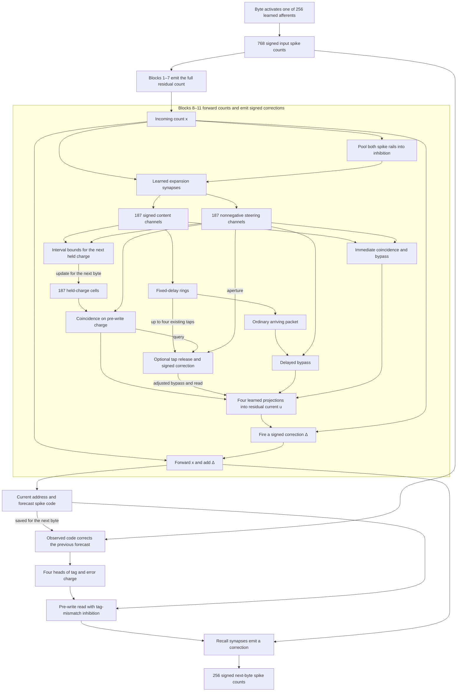

# ShuntFormer v7 model card

The bundled weights are the continued 11-block SNN with **9,960,960
parameters** at **101,580,800 cumulative enwik8 next-byte targets**.
The shortest-tap and spike-race checkpoints restore from the release
archive. Both variants add 1,352 conductances and share the same
29,674-byte persistent tensor budget.
[Bundled weights](weights.pt) · [Exact configuration and hashes](manifest.json) ·
[Restore and replay](../../docs/HANDOFF.md#checkpoints) ·
[Matched results](../../docs/LEADERBOARD.md)

## End-to-end circuit

### Local firing and routing

Each block expands the residual spike counts into content $p$ and
steering $s$ with learned synapses. The shared inhibitory pool
integrates absolute incoming counts at a threshold of 2,048. It
raises the eight-bit router threshold for both populations from
256 to $256+64h$ ticks, where $h$ is the pool's fired count.
The firing resolution is 16 and local content counts are bounded
by 512. Afferents, the memory bank, and vocabulary synapses use
six fractional bits.

The steering count exposes $\operatorname{sign}(p)\min(|p|,s)$
and the remaining pulses take the immediate bypass. The ordinary
delayed bypass uses the same rule on the arriving packet. The
held cell emits the exposed part of its previous charge $m$.
For the next byte, the cell clamps $m$ into $[p-s,p+s]$ within
the local count range. Parallel training and chunk inference perform
the same write with an interval scan.

The four routes project into a shared residual current $u$.
The first seven blocks emit $\operatorname{FIRE}(\theta x+u)$.
Blocks 8–11 forward $x$ and emit the signed difference
$\Delta=\operatorname{FIRE}(\theta x+u)-x$. The four appended
blocks inherit their circuit from v6.
[Decoder source](../../snnformer/event_lm.py) ·
[v6 circuit and residual emission audit](../../docs/DEPTH_GROWTH.md)

### Optional timing read

Each axon group with more than one available tap uses its held read
as a query. Current steering limits which spikes enter the
comparison. Mismatched counts deliver inhibitory charge and delay
a candidate's release. The earliest release selects its own full
packet. The same learned conductance on each channel determines
how strongly that packet corrects the ordinary arrival. The
correction updates the coincident read and delayed bypass before
their original projections. The shortest-tap control chooses a
fixed candidate among the same arrivals. Both use the ordinary
axons for held-charge writes.
[Equations, trainable circuit, and interventions](../../docs/TRACE_TAP_READ.md)

### Tagged error memory

The final local spikes select up to one address per active head.
Each of the four heads has 14 slots. Each slot holds two learned
tag counts and six forecast-error counts. At byte $t$, the
saved address from $t-1$ receives its saved tag and the error
between the new observed code and the previous forecast. A
learned tolerance bounds the error write. The current address
reads pre-write charge. Tag distance outside its tolerance
emits inhibition, and the largest excess over the two tag
coordinates cancels coincident payload pulses. Recall synapses
fire a correction that is added before the vocabulary neurons.
[Charge updates](../../snnformer/correction_memory.py) ·
[Tag circuit and interventions](../../docs/SPIKE_CODE_FORECAST.md)

## Native stream state

| Persistent component | Bytes per stream |
|---|---:|
| Fixed-delay axon rings, Int16 | 19,302 |
| Held charge, 11 × 187 Int32 cells | 8,228 |
| Four tag and error banks, Int32 | 1,792 |
| Previous address spike counts, Int32 | 224 |
| Previous forecast spike counts, Int32 | 128 |
| **Total** | **29,674** |

The per-block group widths are 47, 47, 47, and 46. The three
delay schedules cycle through `[1, 1, 2, 3]`, `[1, 2, 4, 8]`,
and `[1, 3, 9, 27]`. The fixed path spans up to 125 history
bytes. Held charge and bank cells persist while the successive
write rules admit their contents. State capacity stays fixed
with stream length. Byte position, model weights, and temporary
workspace are reported separately from persistent tensor bytes.
The Int16 held-charge option uses the same count range and
widens back to the native working dtype for arithmetic.
[Packed-width audit](../../docs/TRACE_TAP_READ.md#expand-within-32-kib)

## Training and evaluation

The 91,750,400-target parent continued for 2,400 AdamW updates,
with eight 512-byte enwik8 windows per update, seed 6899 and
96 warmup steps. The peak learning rate was 0.0002, with cosine
decay to a 2% floor and gradient clipping at 1.0. AdamW used
$\beta=(0.9,0.99)$ and 0.05 weight decay on non-position matrices.
The objective combines next-byte cross-entropy, a 0.25-weighted
next-code smooth L1 loss, and a soft 310,000-pulse target.
[Exact training record](../../results/event_lm/trace_tap_read/event_correction_code_s6899_trace_tap_control.json)

Training updates FP32 master weights with a quantized forward
and surrogate gradients. The CPU loader quantizes synapses to
integer ticks once. Greedy generation reads the vocabulary
argmax. Probability scores use $\ln(2)/(8\times16)$ times the
counts. PG-19 temperatures are fitted on eight separate books.
The score files cover 4,999,999 enwik8 test targets and 8,404,368
targets from 16 complete PG-19 books. The integer audit compares
CPU chunk and byte-step execution with the quantized Metal path.
The bundled checkpoint scores 1.81319 bpb on enwik8 and 2.77756 bpb
on calibrated PG-19. It generates 309,354 pulses per byte on the
4,096-byte native enwik8 test sample.
[Native audit](../../results/event_lm/trace_tap_read/native_control_s6899.json) ·
[Evaluation protocol](../../docs/HANDOFF.md#score-checkpoints)

## License

Licensed under the GNU Affero General Public License, version 3 only (AGPL-3.0-only), copyright 2026 control-f and Daniel Tremer; commercial licenses without the AGPL's conditions are available from control-f. See the repository's [LICENSE](../../LICENSE) and [NOTICE](../../NOTICE).
