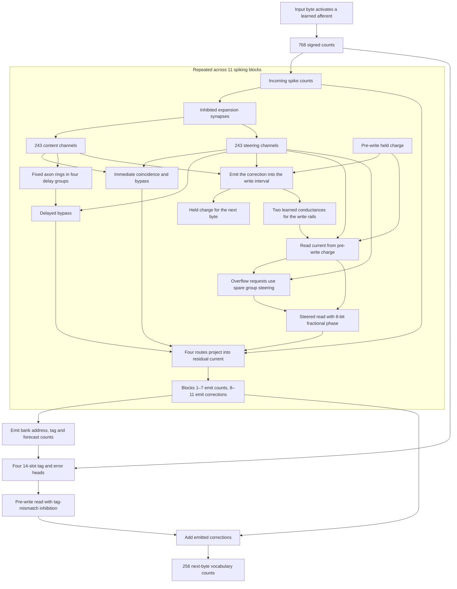

# ShuntFormer v8 model card

The bundled checkpoint uses **two write rails and shared steering**
with eight-bit fractional read charge. It has 12,804,834 trainable
parameters and uses 31,257 bytes of persistent tensor state per
stream. It was trained through 116,326,400 enwik8 next-byte targets.
Its learned read drive changes native firing counts and improves
loss in a fixed-weight validation intervention.
[Weights](weights.pt) · [Configuration and hashes](manifest.json) ·
[Restore and replay](../../docs/V8_HANDOFF.md)

## Architecture

### The local circuit

The afferent projects the byte to 768 signed spike counts. Each
block's inhibition neuron pools absolute incoming counts at a
threshold of 2,048 and raises the resting router threshold of 256
by 64 ticks per inhibitory pulse. Content and steering fire at
16× resolution. Local counts are bounded by 512. Positive and
negative counts encode opposing pulse trains. Local expansion and
projection synapses use eight fractional bits. Afferent, bank and
vocabulary synapses use six.

For content $p$ and steering $a$, the immediate path exposes
$\operatorname{sign}(p)\min(|p|,a)$ and sends the remaining pulses
through the bypass. The axon rings carry earlier content pulses
and the current aperture also limits the delayed path. For
pre-write charge $h$, the cell moves $h$ into $[p-a,p+a]$ within
its count bounds. The local displacement $\Delta=h_{\mathrm{next}}-h$
is an emitted signed write correction. Each read neuron learns one
conductance for positive writes and one for negative writes. The
two gains let the neuron respond to the direction and magnitude
of the change.

The read starts from the aperture-limited old charge count $r$,
and forms $u=256r+g_+[\Delta]_++g_-[-\Delta]_+$, where
$[x]_+=\max(x,0)$. If $|u|$ exceeds the current aperture, it
emits one request per additional whole pulse of aperture needed,
up to the firing cap. Cells in the same delay group donate whole
unused steering pulses. The group conserves its steering budget
and each donor retains its admitted current. The read clips $u$
to the adjusted aperture and emits $s=\lfloor(\phi+q)/256\rfloor$
for the clipped current $q$. The remainder
$\phi+q-256s$ carries into the next byte. A single unsigned byte
preserves fractional charge without changing the firing cap.
The four input routes feed a learned residual projection. The
first seven blocks emit the full new count. Blocks 8–11 forward
incoming counts and emit the signed correction to that count.
[Neuron code](../../snnformer/event_lm.py) ·
[Read derivation and matched controls](../../docs/TRACE_READ_DRIVE.md)

### Error memory and output

Each active head can address one of 14 cells. A cell holds two
learned context-tag counts and six forecast-error counts. The
previous byte's address receives the error between its forecast
and the newly observed code. A learned tolerance bounds its
write. Current addresses read the pre-write contents. The largest
excess on either tag coordinate emits inhibition and cancels
payload pulses. Recall spikes correct the local decoder counts
before the 256 vocabulary neurons fire.
[Bank and interval scan](../../snnformer/correction_memory.py) ·
[Error and tag experiments](../../docs/SPIKE_CODE_FORECAST.md)

## Persistent state

| Tensor component | Bytes per stream |
|---|---:|
| Fixed-delay content rings, Int16 | 21,094 |
| Held charge, 11 × 243 Int16 cells | 5,346 |
| Fractional read charge, 11 × 243 UInt8 phases | 2,673 |
| Four tag and error banks, Int32 | 1,792 |
| Previous address counts, Int32 | 224 |
| Previous forecast counts, Int32 | 128 |
| **Total** | **31,257** |

The group widths are 75, 75, 47 and 46. The delays cycle through
`[1, 1, 2, 3]`, `[1, 2, 4, 8]` and `[1, 3, 9, 27]` across
blocks. The longest fixed path spans 125 history bytes. Held
charge and bank cells can persist until subsequent writes change
them. The table counts persistent tensor storage. Model weights,
byte position and temporary workspace are separate.
[Delay-group placement and warm-start checks](../../docs/PACKED_WIDTH.md#add-channels-to-the-shortest-delay-groups)

## Training and evidence

The bundled run starts from the 111,411,200-target short-group
SNN. It adds 1,200 AdamW updates with eight 512-byte windows per
update, seed 8237, 48 warmup updates and a peak learning rate of
0.00008. AdamW uses $\beta=(0.9,0.99)$, 0.05 weight decay on
non-position matrices and a gradient norm limit of 1.0. The
learning rate decays to a 2% floor on a cosine schedule. Its
objective combines next-byte cross-entropy, 0.25-weighted
next-code prediction and a soft target of 310,000 pulses per
byte. Training uses FP32 master weights and surrogate
gradients with the quantized forward pass. CPU inference executes
integer synapses, bounded spike counts and integer state updates.
Generation reads the largest vocabulary count. Scoring scales
counts by $\ln(2)/(8\times16)$ and fits PG-19 temperature on
separate books.
[Exact run record](../../results/event_lm/trace_read_drive/event_correction_code_s8237_trace_read_drive_write_rails_share.json)

The bundled weights score **1.79464 bpb** on enwik8 and
**2.75590 bpb** on calibrated PG-19, with raw PG-19 loss of
**2.84506 bpb**. The full-attention control scores 1.71363,
2.88478 and 3.08081 bpb respectively at matched parameter count
and exposure. The native test audit observes 308,742 emitted
pulses per byte and 5.786 absolute read-count changes per byte.
Zeroing the learned drive raises loss by 0.000346 bpb and disabling
the shared aperture raises loss by 0.000537 bpb on the 65,536-target
validation intervention.
[Native audit](../../results/event_lm/trace_read_drive/native_write_rails_share_s8237.json) ·
[Drive interventions](../../results/event_lm/trace_read_drive/probe_write_rails_share_s8237.json) ·
[Full leaderboard](../../docs/LEADERBOARD.md)

## License

Licensed under the GNU Affero General Public License, version 3 only (AGPL-3.0-only), copyright 2026 control-f and Daniel Tremer; commercial licenses without the AGPL's conditions are available from control-f. See the repository's [LICENSE](../../LICENSE) and [NOTICE](../../NOTICE).
