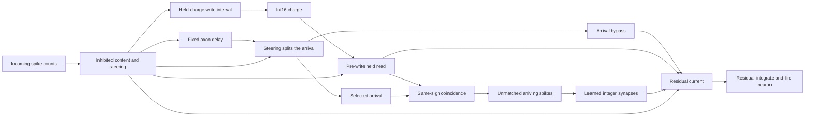

# ShuntFormer v9 model card

The bundled research checkpoint uses **unmatched fixed arrivals**.
It has 14,066,688 trainable parameters and 28,584 bytes of
persistent tensor state per stream. The checkpoint starts from
the ordinary v8 fixed-routing control and has seen 121,241,600
enwik8 next-byte targets.
[Exact configuration and hashes](manifest.json) ·
[Arrival study](../../docs/FIXED_ARRIVALS.md) ·
[Restore and replay](../../docs/V9_HANDOFF.md)

## Circuit

A byte activates one learned afferent and produces 768 signed input
counts. Each of 11 blocks expands them into 243 content and 243
steering channels. An inhibitory pool raises both firing thresholds
in response to incoming activity. The circuit uses eight fractional
bits for the local synapses and 16× firing-count resolution. The
first seven blocks fire the full residual count. The final four
forward incoming counts and emit the signed correction.

The content packet goes through four fixed-delay groups and
proposes a bounded interval for held charge. The read uses the
starting charge before it updates. Let `a` be the portion of the
scheduled arrival opened by steering and `r` the held read. Their
intersection takes the smaller count on each sign rail. The new
synapses receive `a - coincidence(a, r)` in the two fastest groups.
The result keeps the sign of the arrival and its magnitude is at
most the number of selected arrival pulses. The active projected
current feeds the block's existing firing neuron.

The prediction bank stores two tag counts and six forecast-error
counts per cell in four heads with 14 cells each. A prior forecast
and the new observation provide the error written to the prior
address. During recall, tag mismatch fires inhibition on the payload.
The recalled correction and the local network drive 256 vocabulary
neurons.
[Integer decoder](../../snnformer/event_lm.py) ·
[Tagged charge updates](../../snnformer/correction_memory.py)

## State and training

| Persistent component | Bytes per stream |
|---|---:|
| Fixed-delay Int16 rings | 21,094 |
| Int16 held charge across 11 blocks | 5,346 |
| Int32 tag and forecast-error cells | 1,792 |
| Prior address and forecast counts | 352 |
| **Total** | **28,584** |

The trained group widths are 75, 75, 47 and 46. The schedules
cycle through `[1, 1, 2, 3]`, `[1, 2, 4, 8]` and
`[1, 3, 9, 27]`. The added synapses connect the first 150
channels of each block to its 768 residual neurons. The complete
bank update, fixed-delay routing and vocabulary output execute
on integer counts in the CPU decoder.

Training adds 1,200 AdamW updates with eight 512-byte windows,
seed 9349, peak learning rate 0.00008 and 48 warmup updates.
The loss combines next-byte cross-entropy, a 0.25-weighted
forecast-code term and a soft budget of 310,000 emitted pulses
per byte. Quantized forward values use FP32 master parameters
and surrogate gradients during training.

The warm audit verifies every output count and the exact
emission totals on 4,096 validation bytes. CPU integer batch
and chunk inference agree with the Metal forward pass. Integer
byte-step inference matches the output at the first 513 byte positions.
All eleven added matrices receive next-byte gradients.
[Warm audit](../../results/event_lm/trace_arrival/warm_unmatched.json) ·
[Exact training record](../../results/event_lm/trace_arrival/event_correction_code_s9349_trace_arrival_unmatched.json) ·
[Matched scores](../../docs/LEADERBOARD.md)
