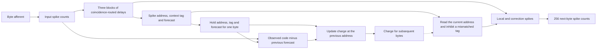

# Spiking byte language model

`weights.pt` is the fixed-threshold context-tag model from seed 1 of the
larger matched study. It was selected by enwik8 validation loss, 2.27532
bits per byte. The model has 815,232 parameters and 32,696 bytes of
streaming tensor state. The [manifest](manifest.json) records its exact
configuration, checksum, training record, and the contents of the
checkpoint release.

From the repository root, install [the requirements](../../requirements.txt)
and run the integer CPU decoder.

```bash
python experiments/generate_event_lm.py models/spiking-byte-lm/weights.pt \
  --prompt 'The first chapter' --bytes 128
```

The generator writes raw continuation bytes to stdout. Use
`--prompt-file` to supply raw input bytes. The checkpoint stores FP32
training weights. The generator exports the circuit to integer synapses
and processes one byte at a time.

## Architecture

Each byte fires one of 256 input afferents. The embedding drives a
192-channel spike representation. Three blocks expand into 201 content
channels and 201 steering channels each. Each block groups its channels
over four delays and uses coincidence to split every signed content
packet into two paths. The coincident and remaining spikes go through
separate learned synapses. The released model uses 16× spike count
resolution and resets neuron charge for each byte. Its delay rings and
correction bank carry information across bytes.



Each of the four bank heads has 14 cells. A cell stores two context tag
coordinates and six signed error coordinates. A read uses the current
address and compares the current tag to the stored one. The largest
tag error outside the learned tolerance emits inhibitory pulses. Those
pulses suppress the coincident part of the recalled correction. When
the observed byte arrives, the previous address receives its context
tag and the difference between its forecast and the observed input
spike code. The cell moves to the nearest charge inside the error
tolerance. Recall adds spikes to the local representation before the
single vocabulary projection.

| Streaming tensor | Layout | Bytes |
|---|---|---:|
| Delay pulse rings | 201 int32 channels across 3, 8, and 27 positions | 30,552 |
| Bank charges | 4 heads × 14 cells × 8 int32 coordinates | 1,792 |
| Previous addresses | 4 heads × 14 int32 slots | 224 |
| Previous tag and forecast | 4 heads × 8 int32 coordinates | 128 |
| Total | One stream | **32,696** |

The block delay groups are `[1, 1, 2, 3]`, `[1, 2, 4, 8]`, and
`[1, 3, 9, 27]`. The local router can use the current byte and up to
38 earlier bytes. The bank can carry charge across a whole document.
The learned-threshold alternative shares one integer firing threshold
between the content and steering neurons in each delay group. It changes
the pulse count and the charge delivered per retained pulse together.
[Decoder](../../snnformer/event_lm.py) ·
[Correction memory](../../snnformer/correction_memory.py) ·
[Threshold and tag experiments](../../docs/SPIKE_CODE_FORECAST.md#learned-context-keys-and-firing-thresholds)

## Checkpoints and data

The [GitHub release](https://github.com/DanielTea/transformer-snn/releases/tag/spiking-byte-lm-v1)
contains 36 trained checkpoints from the main comparison and paired
router test, plus the three router parents used for continuation.
Download and verify the archive from the repository root.

```bash
mkdir -p checkpoints/downloads
gh release download spiking-byte-lm-v1 --repo DanielTea/transformer-snn \
  --pattern 'spiking-byte-lm-checkpoints*' --dir checkpoints/downloads
(
  cd checkpoints/downloads
  shasum -a 256 -c spiking-byte-lm-checkpoints.sha256 &&
  tar -xzf spiking-byte-lm-checkpoints.tar.gz &&
  shasum -a 256 -c checkpoints/SHA256SUMS
)
```

Place the raw 100,000,000-byte file from the enwik8 archive at
`data/enwik8`. The loader checks its SHA-1 and uses the first 90 million
bytes for training, the next five million for validation, and the
last five million for testing. PG-19 is used for held-out testing
and disjoint temperature calibration. The manifests pin the source
objects and verify the exact files.
[enwik8 source](https://www.mattmahoney.net/dc/textdata.html) ·
[Corpus preparation notes](../../docs/REPRODUCE_DENDRITE.md)

```bash
python experiments/prepare_pg19.py \
  --manifest results/event_lm/correction_pg19_full_book_manifest.json --output data/pg19-test
python experiments/prepare_pg19.py \
  --manifest results/event_lm/correction_pg19_validation_manifest.json --output data/pg19-validation
```

## Training and continuation

The released checkpoint trained on 13,107,200 enwik8 targets over
3,200 steps with eight 512-byte windows per step. AdamW used a peak
learning rate of 0.003, 80 warmup steps, and a cosine schedule. The
next-byte loss included a 0.25-weighted forecast loss on the six error
lanes per head and a penalty targeting an average of 310,000 pulses
per byte. The two context tag lanes learn through their effect on
recall. The runs used Python 3.12.8 and PyTorch 2.15.0 on Apple MPS.
The [training JSON](../../results/event_lm/event_correction_code_s1_threshold_scale_large_context.json)
records every flag, the seed, and the validation curve.

Replay a published run with an exact copy of its saved arguments and
your own data path. By default, checkpoints and results go under
`checkpoints/replayed`. Add `--dry-run` to print the command, or
`--parent-checkpoints checkpoints/downloads/checkpoints` for a run
with a parent in the release archive.

```bash
PYTORCH_ENABLE_MPS_FALLBACK=0 python experiments/replay_event_run.py \
  results/event_lm/event_correction_code_s1_threshold_scale_large_context.json \
  --enwik8 data/enwik8 --device mps
```

Start a new experiment from the released weights with the same
architecture. The checkpoint is a weight snapshot, so continuation
starts a fresh AdamW optimizer.

```bash
PYTORCH_ENABLE_MPS_FALLBACK=0 python experiments/train_event_lm.py \
  --variant event_correction_code --data data/enwik8 --device mps \
  --dim 192 --hidden 201 --depth 3 --no-carry --spike-resolution 16 \
  --memory-heads 4 --memory-slots 14 --memory-width 32 --forecast-key-channels 2 \
  --learn-context-keys --match-forecast-key --pulse-budget 310000 --code-loss-weight 0.25 \
  --initialize-from models/spiking-byte-lm/weights.pt \
  --ctx 512 --bs 8 --steps 400 --warmup 32 --lr 0.00075 --seed 42 --validation-only \
  --tag continuation --results-dir checkpoints/work/results --checkpoint checkpoints/work/continuation.pt
```

## Score the released checkpoint

Use `--device mps` for the recorded Apple GPU protocol or `--device cpu`
to score on CPU. These commands write new records under
`checkpoints/work`.

```bash
score=(python experiments/eval_event_lm.py --device mps --context 2048
       --history 256 --batch-size 8 --checkpoint models/spiking-byte-lm/weights.pt)
"${score[@]}" --enwik8 data/enwik8 --json checkpoints/work/enwik8.json
"${score[@]}" --books-dir data/pg19-test \
  --manifest results/event_lm/correction_pg19_full_book_manifest.json \
  --calibration-books data/pg19-validation \
  --calibration-manifest results/event_lm/correction_pg19_validation_manifest.json \
  --temperatures 0.8 1.0 1.15 1.25 1.4 1.5 1.65 1.8 2.0 2.25 \
  --json checkpoints/work/pg19.json
```

The fixed-threshold bank's 3.25043 PG-19 score is the three-seed mean.
The model has the same parameter count and training exposure as the
matched Transformer references. Its mean advantage over the local
Transformer came from one seed. Its enwik8 loss was 0.19559 bits per
byte higher than the local Transformer’s. The tag and threshold
controls record the effects of stored keys, older reads, and pulse
activity separately.
[Matched leaderboards](../../docs/LEADERBOARD.md) ·
[Full protocol and interventions](../../docs/SPIKE_CODE_FORECAST.md#learned-context-keys-and-firing-thresholds)

## Source and reports

| Work | Source |
|---|---|
| Spike decoder, packet thresholds and CPU export | [event_lm.py](../../snnformer/event_lm.py) |
| Charge writes and recall | [correction_memory.py](../../snnformer/correction_memory.py) |
| Training and exact replay | [train_event_lm.py](../../experiments/train_event_lm.py), [replay_event_run.py](../../experiments/replay_event_run.py) |
| Complete test scores and memory interventions | [eval_event_lm.py](../../experiments/eval_event_lm.py) |
| CPU parity and pulse counts | [audit_spike_code.py](../../experiments/audit_spike_code.py) |
| Checkpoint archive | [package_event_lm.py](../../experiments/package_event_lm.py) |
| Generated leaderboard and figures | [plot_event_lm_study.py](../../experiments/plot_event_lm_study.py) |
| Browser report | [make_report.py](../../experiments/make_report.py) |

Run `python -m pytest -q` to test the circuit, streaming state, and
controls. The pinned score records and the plots are available directly
from [the results index](../../results/README.md).

## License

Licensed under the GNU Affero General Public License, version 3 only (AGPL-3.0-only), copyright 2026 control-f and Daniel Tremer; commercial licenses without the AGPL's conditions are available from control-f. See the repository's [LICENSE](../../LICENSE) and [NOTICE](../../NOTICE).
